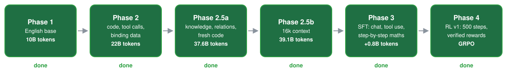

# BubblSpace MoE-0.9B-A0.2B

**Project homepage: [bubblspace.com](https://bubblspace.com)** · [Hugging Face](https://huggingface.co/TheFireHacker/bubblspace-moe0.9b-a0.2b) · [Training states](https://huggingface.co/TheFireHacker/bubblspace-moe0.9b-a0.2b-training-states) · [W&B](https://forge.coreweave.com/wandb/firehacker/moe0-9b-a0-2b)

> 🏆 **BubblSpace MoE-0.9B-A0.2B is ahead of OLMo-2 1B and Pythia on WinoGrande twin pairs at the same token count.** [Details](#winogrande-twin-pairs-at-three-levels-phase-2-final-step-22888)

A small Mixture-of-Experts language model trained from scratch on one H100: **≈915M parameters, ≈211M active per token**, built for **coding and agentic tool use**. Everything is open: the weights, every checkpoint with its optimizer state, the training code and the data pipeline.

<p></p>

> ⚠️ **A small model for learning.** BubblSpace is a small model built to learn, and to show, how language models are trained. Its outputs are not reliable, so don't depend on them. The whole project is open source to help others learn.

## Where we are

<p align="center"></p>

Token counts are cumulative. **Pretraining, supervised fine-tuning and a first RL round are complete.** The RL model (RL v1 step 500) is on Hugging Face `main`. Next: decide from the benchmarks whether a knowledge round or a bigger RL comes first ([plan](doc/plan-06-phase-4-rl.md)).

| Phase | What it adds | Tokens (total) | Highlight | Status |
|---|---|---|---|---|
| **1** | English base (FineWeb-Edu) | 10B | English 6-task average 47.2 | ✅ 19,073 steps, 32 h |
| **2** | code, tool calls, synthetic binding data ([plan](doc/plan-02-phase-2-continual-training.md)) | 22B | HumanEval 14.6% · MBPP 18.2% · the WinoGrande twin-pair lead | ✅ 22,888 steps, 40 h, 23 Nov |
| **2.5a** | knowledge (full Wikipedia, fact Q&A, SYNTH), relations, fresh code; early LR decay with order-alternated binding data ([plan](doc/plan-03-phase-2.5-knowledge-context.md)) | 37.6B | TriviaQA 15.8% · English average 47.9 · BFCL multiple 26% | ✅ 29,723 steps, 26 Nov |
| **2.5b** | context 2k → 16k (RoPE base 1e6) | 39.1B | passkey retrieval 70% at 4k, 48% at 16k | ✅ 2,861 steps, 27 Nov |
| **3** | SFT: chat, tool calling, agent traces, step-by-step maths; assistant-only loss at 16k ([plan](doc/plan-04-phase-3-sft.md)) | +0.8B | chats, picks the right tool, makes parallel calls, uses tool results ([results](#results)) | ✅ 1,500 steps, 3 h, 27 Nov |
| **4** | RL v1: GRPO with verifiable rewards (maths, time problems, instruction constraints, code in a sandbox, tool calls, binding, refusal balance) ([plan](doc/plan-06-phase-4-rl.md)) | +500 RL steps | BFCL parallel 24 → 40% · IFEval 23 → 30% · GSM8K 9.6 → 12.4% · no forgetting ([results](#results)) | ✅ 500 steps, 1 h 40 min, 27 Nov |

## Checkpoints

| | Where |
|---|---|
| **Latest weights**: Phase 4 RL v1 step 500 (SFT run 02b + 500 GRPO steps), 16k context | `main` of [huggingface.co/TheFireHacker/bubblspace-moe0.9b-a0.2b](https://huggingface.co/TheFireHacker/bubblspace-moe0.9b-a0.2b) (also branch [`phase4-rlv1-step500-tokens40B`](https://huggingface.co/TheFireHacker/bubblspace-moe0.9b-a0.2b/tree/phase4-rlv1-step500-tokens40B)); tokenizer includes the chat template |
| RL v1 steps 100 / 300 | branches [`phase4-rlv1-step100-tokens40B`](https://huggingface.co/TheFireHacker/bubblspace-moe0.9b-a0.2b/tree/phase4-rlv1-step100-tokens40B), [`phase4-rlv1-step300-tokens40B`](https://huggingface.co/TheFireHacker/bubblspace-moe0.9b-a0.2b/tree/phase4-rlv1-step300-tokens40B) |
| SFT models | run 02b (the RL start): [`phase3-run02b-step1500-tokens40B`](https://huggingface.co/TheFireHacker/bubblspace-moe0.9b-a0.2b/tree/phase3-run02b-step1500-tokens40B), [`phase3-run02b-step1000-tokens40B`](https://huggingface.co/TheFireHacker/bubblspace-moe0.9b-a0.2b/tree/phase3-run02b-step1000-tokens40B); run 01: [`phase3-step1500-tokens40B`](https://huggingface.co/TheFireHacker/bubblspace-moe0.9b-a0.2b/tree/phase3-step1500-tokens40B) (`main` until 28 Nov), [`phase3-step1000-tokens40B`](https://huggingface.co/TheFireHacker/bubblspace-moe0.9b-a0.2b/tree/phase3-step1000-tokens40B) |
| Base model (last pretraining checkpoint) | branch [`phase25b-step2861-tokens39B`](https://huggingface.co/TheFireHacker/bubblspace-moe0.9b-a0.2b/tree/phase25b-step2861-tokens39B): Phase 2.5b final, 16k context, no SFT |
| Earlier weights | branches [`phase2-step22888-tokens22B`](https://huggingface.co/TheFireHacker/bubblspace-moe0.9b-a0.2b/tree/phase2-step22888-tokens22B) (Phase 2 final, the WinoGrande checkpoint), [`phase2-step19000`](https://huggingface.co/TheFireHacker/bubblspace-moe0.9b-a0.2b/tree/phase2-step19000), [`phase2-step9000`](https://huggingface.co/TheFireHacker/bubblspace-moe0.9b-a0.2b/tree/phase2-step9000), [`phase1-final`](https://huggingface.co/TheFireHacker/bubblspace-moe0.9b-a0.2b/tree/phase1-final) |
| **Full training states** (weights + optimizer + schedulers + RNG, to resume or branch training) | [huggingface.co/TheFireHacker/bubblspace-moe0.9b-a0.2b-training-states](https://huggingface.co/TheFireHacker/bubblspace-moe0.9b-a0.2b-training-states): one branch per checkpoint, named like OLMo's `<phase>-step<N>-tokens<X>B` (18: the last two of every stage, from `phase1-step19000-tokens10B` to `phase4-rlv1-step500-tokens40B`; the RL branches carry every rollout; training logs under [`logs/`](https://huggingface.co/TheFireHacker/bubblspace-moe0.9b-a0.2b-training-states/tree/main/logs)). Restore with [`scripts/restore_checkpoint.py`](scripts/restore_checkpoint.py) |
| Training logs (public W&B) | Phase 1 [goa8jk6e](https://forge.coreweave.com/wandb/firehacker/moe0-9b-a0-2b/runs/goa8jk6e) · Phase 2 [lec9ww5h](https://forge.coreweave.com/wandb/firehacker/moe0-9b-a0-2b/runs/lec9ww5h) · 2.5a [l2i2yoqf](https://forge.coreweave.com/wandb/firehacker/moe0-9b-a0-2b/runs/l2i2yoqf) · 2.5b [9be9emiq](https://forge.coreweave.com/wandb/firehacker/moe0-9b-a0-2b/runs/9be9emiq) · SFT run 01 [qq4dnyp4](https://forge.coreweave.com/wandb/firehacker/moe0-9b-a0-2b/runs/qq4dnyp4) · SFT run 02b [6dz3e9d5](https://forge.coreweave.com/wandb/firehacker/moe0-9b-a0-2b/runs/6dz3e9d5) · RL v1 [0qt8oyzz](https://forge.coreweave.com/wandb/firehacker/moe0-9b-a0-2b/runs/0qt8oyzz) |
| License | [Apache 2.0](LICENSE) |

## Results

**Phase 4 (RL v1) results**

RL v1 ran **500 steps of GRPO with verifiable rewards** on top of SFT run 02b: the model answers each question 8 times, plain-code checkers score every answer (maths, time problems, instruction constraints with known answers, code run in a docker sandbox, tool calls incl. parallel and no-tool-needed, who-did-what, refusal balance), and training raises the better answers ([plan](doc/plan-06-phase-4-rl.md), [primer](doc/rl-primer-phase4.md)). 1 h 40 min on one H100, generation through our vLLM plugin.

Chat benchmarks, all models evaluated the same way (A10, vLLM backend, greedy; raw results in [`benchmark/phase4/`](benchmark/phase4/)):

| Model | Harmless refused | Harmful refused | Live data honest | HumanEval % | MBPP % | GSM8K % | IFEval prompt / instr. % | BFCL simple | BFCL multiple | BFCL parallel | BFCL no tool needed |
|---|---|---|---|---|---|---|---|---|---|---|---|
| SFT run 01 | 9/45 | 8/8 | 6/8 | 15.2 | 22.6 | 10.0 | 26.1 / 38.1 | 57.0 | 40.0 | 31.0 | 75.4 |
| SFT run 02b (RL start) | 1/45 | 8/8 | 7/8 | 15.2 | 21.8 | 9.6 | 23.1 / 36.0 | 63.0 | 36.0 | 24.0 | 56.2 |
| RL v1 step 100 | 1/45 | 7/8 | 8/8 | 15.9 | 22.4 | 10.5 | 28.1 / 40.3 | 68.0 | 42.0 | 37.0 | 71.7 |
| RL v1 step 300 | 0/45 | 7/8 | 8/8 | 15.9 | 22.8 | 12.3 | 27.9 / 41.8 | 70.0 | 37.0 | 34.0 | 75.4 |
| **RL v1 step 500 (`main`)** | **0/45** | 7/8 | **8/8** | **16.5** | 22.2 | **12.4** | **29.6 / 43.5** | **71.0** | **43.0** | **40.0** | 69.6 |

- **Tool calling:** RL recovered run 02b's losses and went past both SFT runs on simple, multiple and parallel calls (parallel 24 → 40%); "no tool needed" back near run 01.
- **Instructions and maths:** best IFEval of any of our models; GSM8K 9.6 → 12.4% (maths stays weak: most maths tasks were never solved in 8 tries before RL, a knowledge gap rather than an RL target).
- **Refusals:** answers every harmless prompt in our 45-prompt check, says when it has no live data, refuses 7 of 8 clearly harmful requests (the eighth it discourages without a refusal phrase).
- **No forgetting:** English 6-task average 47.91 (run 02b) → 48.00 (RL v1).
- **Chat test:** passive sentences right for the first time ("The letter was written by Maya… who wrote it?" → Maya), two calls for "weather in Tokyo and London", shorter direct answers.

**Pass@8** (8 answers per question at temperature 1.0; [summary](benchmark/phase4/passk/summary.md)): RL v1 raised pass@8 or kept it level on every task (GSM8K 19.6 → 31.8%), so it didn't narrow what the model can reach. The gap between greedy and pass@8 shows where a bigger RL can still help: IFEval 30 vs 55%, BFCL multiple 43 vs 67%, GSM8K 12 vs 32%. Two-thirds to three-quarters of HumanEval, MBPP and GSM8K questions are never right in 8 tries: that part needs more code and maths knowledge, not more RL.

**Hand tests and long context** ([summary](benchmark/phase4/handtest_longctx/summary.md)): on the 18 relational and 16 calculation prompts of our OLMo comparison, RL v1 scores 10/18 and 9/16 as raw text (2.5a base: 6/18 and 5/16; OLMo-2 1B final base: 9/18 and 10/16) and 8/18 and 12/16 in chat (SFT run 02b: 5/18 and 8/16; OLMo-2 1B Instruct: 14/18 and 16/16). Days of the week, time order and swapping stay wrong. Long-context retrieval is kept as raw text (passkey 85% at 2k, 83% at 8k, 50% at 16k), but drops when the document comes as a chat message (75 / 38 / 33%): long-document questions in the chat format are the next gap to train.

BFCL has 100 questions per category (±5 points is noise). The overnight continuation of RL (v1b/v1c) didn't run: its first step hung and the H100 was retired ([details](doc/plan-06-phase-4-rl.md)).

**Phase 3 (SFT) results**

Phase 3 fine-tuned the Phase 2.5b base model into a chat model: 1,500 steps, ≈0.8B tokens in 16k-token blocks, loss on assistant tokens only, learning rate 6e-5 decaying to 0 (3 h on one H100). Data: Tülu 3 (OLMo-2 mix) for chat, ToolMind, Glaive and Hermes for function calling, Nemotron terminal traces, SYNTHETIC-1 verified code and maths, GSM8K train, our own fact, arithmetic, binding and identity sets, and 6% pretraining replay. Every set was decontaminated against the evals.

**Hand test, 23 conversations** (greedy, no repetition penalty; [full transcript](benchmark/phase3/chat_smoke_phase3_step1500.md)):

| Area | Result |
|---|---|
| Facts, both directions | ✅ "What is the capital of India?" → New Delhi; "New Delhi is the capital of which country?" → India |
| Instructions | ✅ "three fruits, one per line" → a clean list; "one word only" → `blue` |
| Maths with steps | ✅ 47 + 38 = 85; 7 pens × 12 = 84; 3 × 8 − 5 = 19 |
| Code | ✅ correct string reversal, PyTorch `nn.Module`, FizzBuzz |
| Tool calls | ✅ picks `convert_currency` over `get_weather`; two parallel calls for two cities; turns a tool result into an answer |
| Who did what | ✅ taller-than chain; ❌ "Ravi gave Anita a red cap… who has it?"; ❌ "written by Maya… who wrote it?" |
| No tool needed | ❌ "Hi! How are you?" with tools available → calls `get_weather` |

**What changed:** the base model's quiz-format and hedging habits are gone; it answers directly and stops cleanly at the end of its turn. Tool calls come after a `<think>` block (from the ToolMind data), which makes them slow. Validation loss on plain pretraining text rose only ≈1%, so SFT caused little forgetting.

**Still weak:** binding in "gave" and passive sentences (SFT changed the answer format, not this ability), and knowing when *not* to call a tool. Run 01 also over-refused harmless commands ("give me capital of India" → "I can't provide real-time data": 9 of 45 in our check); run 02b rebalanced the refusal data (1 of 45, [doc/issue-02](doc/issue-02-phase3-over-refusal.md)) and is the model RL started from. Chat benchmarks for both SFT runs are in the Phase 4 table above.

**Phase 2.5 results** (2.5a final vs Phase 2 final, same harness; full tables in `benchmark/phase25a/summary.md` and `benchmark/phase25b/summary.md`):

| | Phase 2 final (22B tokens) | **Phase 2.5a final (37.6B tokens)** |
|---|---|---|
| English 6-task average | 46.92 | **47.88** |
| ARC-Easy / ARC-Challenge | 54.1 / 28.6 | **57.4 / 31.1** |
| LAMBADA | 34.9 | **35.9** |
| TriviaQA / NQ-open (closed-book, 5-shot) | 11.6% / 3.9% | **15.8% / 4.5%** |
| HumanEval / MBPP (pass@1, sandboxed) | 14.6% / 18.2% | **15.2% / 20.6%** |
| BFCL simple / multiple / parallel | 25 / 17 / 1 | 16 / **26** / 0 |
| Bits per byte, English / code (post-cutoff text) | 0.913 / 0.696 | **0.897 / 0.690** |
| Binding probe v5 (held-out structures incl. passives) | 10/120 | **54/120** |

**Long context (Phase 2.5b):**

| Checkpoint | Passkey 4k | Passkey 8k | Passkey 16k | 2-hop 4k | 2-hop 16k | Loss at 1–2k / 8–16k tokens |
|---|---|---|---|---|---|---|
| 2.5b step 1,000 | 62% | 78% | 35% | 21% | 8% | 2.52 / 2.27 |
| 2.5b step 2,000 | 72% | 75% | 45% | 21% | 17% | 2.50 / 2.25 |
| **2.5b final (2,861)** | **70%** | **72%** | **48%** | **29%** | **17%** | **2.49 / 2.24** |
| SFT run 02b (28 Nov) | 73% | 80% | 40% | 29% | 0% | 2.52 / 2.27 |
| RL v1 step 500 (28 Nov) | 73% | 83% | 50% | 13% | 8% | 2.53 / 2.28 |

Passkey: 40 trials per length; 2-hop fact retrieval from the text: 24 per length (chance 25%). Loss keeps falling deeper into a document, so the model uses the long context. Retrieval works well up to 8k and about half the time at 16k; SFT and RL kept it (same raw-text test). In the chat format (document in a user message) passkey falls to 55% at 4k and 33% at 16k for RL v1.

**Phase 2 results** (full table in [`benchmark/README.md`](benchmark/README.md)):

| | Phase 1 final | P2 step 9,000 | P2 step 19,000 | **P2 final (22,888)** |
|---|---|---|---|---|
| CRUXEval-O pass@1 | 0.0% | — | 17.7% | **20.7%** |
| BFCL simple / multiple / parallel (decontaminated) | 0 / 0 / 0% | — | 25 / 13 / 0% | **25 / 17 / 1%** |
| **HumanEval pass@1** (164, sandboxed execution) | 0.0% | 9.1% | 11.6% | **14.6%** |
| **MBPP pass@1** (500, sandboxed execution) | not run (no code training) | 8.4% | 12.6% | **18.2%** |
| Held-out agentic tool-call format (valid, correct name) | 0% | 30% | 35% | 39% |
| Reasoning: closes `</think>` within 512 tokens | 0% | 12% | 0% | 0% |
| English 6-task average | 47.18 | 46.19 | 45.98 | **46.92** |
| Binding probe v2 / v3 | 24/100, 4/70 | 24/100, 3/70 | 30/100, 4/70 | **37/100**, 6/70 |
| Binding probe v4 (held-out phrasings + entities; chance ≈ 28/112) | 13/112 | 11/112 | 17/112 | **77/112** (82 at step 21k) |
| TriviaQA / NQ-open (closed-book, 5-shot) | 8.5% / 2.9% | — | — | 11.6% / 3.9% |

The code scores are not inflated by memorization: problems the model passed overlap the training data no more than ones it failed ([eval notes](doc/eval-notes.md)).

**Published datasets** (ours):
- [`bubblspace-contrastive-binding`](https://huggingface.co/datasets/TheFireHacker/bubblspace-contrastive-binding): template binding corpora v1–v3, plus the binding probes v2–v4 with a canary string. CC BY 4.0.
- [`bubblspace-relational-passages-Qwen3-30B`](https://huggingface.co/datasets/TheFireHacker/bubblspace-relational-passages-Qwen3-30B): grounded, fact-checked relational passages (222,088 in 25 shards, plus the fact-check rejects with critiques), used in Phase 2.5a. CC BY-SA 4.0.

**Mid-run changes (applied at step 19,000 by resuming from the checkpoint; the switch ran automatically on 23 Nov and was verified):**
- Stage 2B keeps FineWeb-Edu at ≈5.7% instead of 0%.
- The contrastive binding data switches to v2 ([`scripts/gen_contrastive_v2.py`](scripts/gen_contrastive_v2.py)): 15 sentence frames instead of 1, pronoun resolution, and varied question formats. The v1 corpus was being memorized as templates.

See [`doc/eval-notes.md`](doc/eval-notes.md) for how every eval is wired up for this custom (non-`transformers`-native) architecture. Storyboards in [`doc/storyboard/`](doc/storyboard/) give the chronological build narrative.

## Architecture summary

| Component | Spec |
|---|---|
| Layers | 16, `d_model=1024` |
| Attention | 16 heads / 4 KV heads (GQA), head_dim 64, QK-norm before RoPE, elementwise output gate, no bias |
| MoE | 64 experts, top-8, SwiGLU, expert_hidden 256, dropless |
| Norm | ZeroCenteredRMSNorm (`1+w`, `w` init 0, weight-decayed) |
| Vocab | 49,280 (bubblspace-tokenizer, padded), tied embedding/lm_head |
| Context | 2,048 tokens (Phases 1–2.5a); 16,384 from Phase 2.5b on (RoPE base 1e6) |

| | Total | Active |
|---|---|---|
| Embedding | 50.5M | 50.5M |
| Attention (incl. output gate) | 58.7M | 58.7M |
| Routers | 1.05M | 1.05M |
| Experts | 805.3M | 100.7M |
| **Total** | **≈915M** | **≈211M** |

Optimizer: Muon (lr 6e-4, momentum 0.95, Nesterov, 5 Newton-Schulz steps, update_scale `0.2*sqrt(max(rows,cols))`, weight_decay 0.1) on every 2D/per-expert-stacked hidden matrix (attn q/k/v/o/gate, expert gate/up/down); AdamW (lr 6e-4, betas 0.9/0.95, weight_decay 0.1) on the tied embedding, routers, and all norm weights. Cosine LR schedule, 2000-step warmup, min_lr_ratio 0.1. Global batch 524288 tokens (256×2048), bf16, `torch.compile`.

Full config: [configs/base.yaml](configs/base.yaml). Cheap smoke-test config: [configs/debug.yaml](configs/debug.yaml).

## Tokenizer

[scripts/build_tokenizer.py](scripts/build_tokenizer.py) builds `bubblspace-tokenizer/` from `HuggingFaceTB/SmolLM2-360M`'s tokenizer (49,152 tokens) — **no new tokenizer is trained**, it only extends the vocabulary:

| Added | Tokens |
|---|---|
| Chat | `<\|im_start\|>`, `<\|im_end\|>` *(already present in the SmolLM2 base tokenizer — skipped)* |
| FIM | `<\|fim_prefix\|>`, `<\|fim_middle\|>`, `<\|fim_suffix\|>`, `<\|fim_pad\|>` |
| Tools | `<tools>`, `</tools>`, `<tool_call>`, `</tool_call>`, `<tool_response>`, `</tool_response>` |
| Reasoning | `<think>`, `</think>` |

Result: 49,152 + 12 new = 49,164 real tokens, padded to **49,280** (multiple of 128) for `model.vocab_size`. The 116 padding rows are never produced by the tokenizer and are sliced out of the loss entirely in `scripts/train.py` (not just left to cross-entropy's target-matching — they're excluded from the softmax too). Embeddings stay tied.

Document separator for pretraining: `<|endoftext|>` (the tokenizer's `eos_token`, id 0), appended after every document. Chat/tool/think tokens are **never** inserted into raw pretraining text; FIM tokens are inserted only into code samples when `--is_code --fim_rate > 0` is passed to `src/data/prepare.py` (see [src/data/fim.py](src/data/fim.py), standard PSM prefix/suffix/middle layout).

Verified locally (`scripts/build_tokenizer.py` + `scripts/sanity_check_data.py`): all 15 special tokens encode to a single id each, round-trip (`decode(encode(x)) == x`) holds on web/Python/math samples. Bytes-per-token vs. GPT-2, measured on real ≈800KB held-out samples (real FineWeb-Edu docs, real Python stdlib source, real FineMath docs — not toy strings):

| Domain | bubblspace bytes/token | GPT-2 bytes/token | Result |
|---|---|---|---|
| Web (FineWeb-Edu) | 4.541 | 4.639 | ≈parity (bubblspace ≈2% more tokens) |
| Python (stdlib) | 3.752 | 2.191 | **bubblspace ≈1.7x more efficient** (≈58% as many tokens as GPT-2) |
| Math (FineMath) | 3.326 | 3.561 | bubblspace ≈7% more tokens (slightly behind) |

Net: no efficiency reason to prefer GPT-2 for this model — bubblspace-tokenizer is clearly better on code, roughly tied on general English, marginally behind on math.

## Benchmarks

Standard base-LM benchmark suite (HellaSwag, PIQA, ARC-Easy/Challenge, WinoGrande, LAMBADA) via [lm-evaluation-harness](https://github.com/EleutherAI/lm-evaluation-harness), scored with a custom adapter since this isn't a `transformers`-native architecture — see [`src/eval/lm_eval_adapter.py`](src/eval/lm_eval_adapter.py) and [`doc/eval-notes.md`](doc/eval-notes.md) for how that's wired up, and [`benchmark/README.md`](benchmark/README.md) for full results tracked per checkpoint, including a comparison against GPT-2-124M, Pythia-160M/410M, and SmolLM2-360M at matched (or smaller) training-token budgets.

```bash
pip install -e ".[eval]"
python scripts/run_benchmarks.py \
    --checkpoint /path/to/step_N.pt \
    --tasks hellaswag,piqa,arc_easy,arc_challenge,winogrande,lambada_openai \
    --output benchmark/step_N.json
```

### WinoGrande twin pairs at three levels (Phase 2 final, step 22,888)

**BubblSpace MoE-0.9B-A0.2B is ahead of OLMo-2 1B and Pythia on WinoGrande twin pairs at the same token count**, with a fraction of their active parameters. It also matches OLMo-2 1B at 42B tokens, about twice the data.

| Model | Tokens | Active params | L2: both twins ranked right | L3: both twins written right |
|---|---|---|---|---|
| **BubblSpace MoE-0.9B-A0.2B** (Phase 2 final) | **22B** | **211M** | **18.3%** | **1.8%** |
| OLMo-2-0425-1B (stage-1 checkpoint) | 21B | ≈1.5B | 17% | 1% |
| Pythia-1.4B / 1B / 410M | 21B | 1.4B / 1B / 410M | 15% / 14% / 14% | 1% / 1% / 1% |
| OLMo-2-0425-1B (stage-1 checkpoint) | 42B | ≈1.5B | 19% | 1% |

**How it's scored.** WinoGrande sentences come in twin pairs: change one word and the correct answer flips.
- **L2:** both twins ranked correctly, Elazar et al. 2021's group scoring. Chance is 25%, and a model with a fixed habit scores below it.
- **L3:** the model *writes* the correct answer itself in both twins (5-shot, greedy).

Single-row WinoGrande (L1) is 52.6%. The harness is the same as our 85-checkpoint cross-model study ([`doc/binding-study-01-cross-model.md`](doc/binding-study-01-cross-model.md)), with 284 twin pairs from WinoGrande-XL validation.

**Caveats:**
- The gaps are 1–4 points on 284 pairs (±≈2.3 points), so the lead over OLMo-2 1B is within noise.
- Phase 2 included synthetic contrastive entity-binding data, which the public models didn't have.
- Every model here is still **below the 25% chance level**, with mostly the same name written for both twins (78% of pairs for BubblSpace). That's a habit, not yet binding.

### Relational prompts, written answers vs OLMo-2 1B across its training (26 Nov, preliminary)

18 short relational prompts (cause/effect, two-step chains, passive roles, fit, family relations, time, counting, swapping, "respectively"), scored on the first answer each model **writes** under raw greedy decoding. Details: [`doc/handtest-01-relational-vs-olmo.md`](doc/handtest-01-relational-vs-olmo.md).

| Model | Total tokens | Right (of 18) | Answers, then stops |
|---|---|---|---|
| **BubblSpace Phase 2 final** | **22B** | **6** | **8** |
| **BubblSpace 2.5a, step 20,000** | **32.5B** | **6** | **6** |
| OLMo-2-0425-1B | 21B | 3 | 0 |
| OLMo-2-0425-1B | 42B | 4 | 0 |
| OLMo-2-0425-1B | 168B | 8 | 0 |
| OLMo-2-0425-1B (end of pretraining) | 4.0T | 10 | 0 |
| OLMo-2-0425-1B (final base, `main`) | ≈4.05T | 9 | 0 |

**Clear wins:**
- **Ahead at matched tokens:** 6/18 at 22B and 32.5B vs OLMo-2 1B's 3/18 at 21B and 4/18 at 42B. OLMo-2 1B passes it at about 5× the tokens (168B).
- **A chain only BubblSpace solves:** "Ravi is taller than Meera, and Meera is taller than Sam, so the shortest is" → "Sam" in both our checkpoints; wrong in all five OLMo-2 1B checkpoints, including the final model.
- **It answers and stops:** our checkpoints end after a short answer on 6–8 prompts. OLMo-2 1B ends on none, at any checkpoint, and mostly loops.
- **Targeted data fixes what scale doesn't:** five items (time order, counting, exclusion, "respectively", the agent of a "taught by" passive) fail in every model, including OLMo-2 1B at 4T. A related failure, passive roles, went from 0 to 40/40 written answers with our order-alternation data in a test fine-tune ([`doc/binding-study-02-priors-and-word-order.md`](doc/binding-study-02-priors-and-word-order.md) §6.1).

**Calculation, 16 simple prompts** (time, counting, ages, prices, days): **BubblSpace 2.5a at 32.5B tokens: 5/16.** OLMo-2 1B base: 1/16 at 42B, 2/16 at 168B, 10/16 at 4T (10/16 for its final base). OLMo-2 1B Instruct (SFT + DPO + RL): 14/16 raw, 16/16 with its chat template, mostly by writing out the steps. Even that fully post-trained model still says "Maria was helped by Joon, so the one who needed help was… Joon".

**Caveats:** 18 + 16 prompts, scored by hand, one greedy run each, so single items are noisy. OLMo-2 1B gets the "beaten by" passive from 42B on, and our checkpoints don't yet: the 2.5a decay includes the order-alternation data aimed at it.

Raw results:
- [`benchmark/handtest/relational18_raw_greedy_20261126.txt`](benchmark/handtest/relational18_raw_greedy_20261126.txt) (relational prompts, all seven models)
- [`benchmark/binding_levels/bubblspace/phase2_step22888.json`](benchmark/binding_levels/bubblspace/phase2_step22888.json)
- [`benchmark/binding_levels/report.md`](benchmark/binding_levels/report.md) (public models)

Scripts: `scripts/binding_levels_bubbl.py` (ours) and `scripts/binding_levels_hf.py` (HF models).

## Training objective / data mixture

**Phase 1:** 100% FineWeb-Edu `sample-10BT` (10B tokens, single pass).

**Phase 2** ([`configs/phase2.yaml`](configs/phase2.yaml), design in [`doc/plan-02-phase-2-continual-training.md`](doc/plan-02-phase-2-continual-training.md) and [`doc/storyboard/04-Phase2-Trainig.md`](doc/storyboard/04-Phase2-Trainig.md)) runs 16 pools in four groups, sampled per row by stage-dependent group weights:

| Group | Pools (sources) | Stage 2A (steps 0–19,073, 10B tok) | Stage 2B anneal (19,073–22,888, 2B tok) |
|---|---|---|---|
| English + knowledge + STEM | Wikipedia `20231101.en`, Cosmopedia-v2, FineMath-4plus, FineWeb-Edu replay | 41.5% | 34% (FineWeb-Edu ≈5.7% of all 2B tokens) |
| Code (window-level FIM, 50/50 PSM/SPM) | `Avelina/python-edu-cleaned`; `bigcode/starcoderdata` Python, TypeScript, JavaScript, Go, SQL/shell/config | 49% | 38% (python-edu ×3) |
| Agentic (block-aligned episodes ≤2048 tokens, pad loss masked) | ToolMind, glaive-function-calling-v2, OpenThoughts-114k, hermes-function-calling-v1, Bespoke-Stratos-17k | 8% | 22% |
| Contrastive binding (synthetic minimal pairs) | 2A: v1 `scripts/gen_contrastive.py`, 61.9M unique tokens; 2B: v2 `scripts/gen_contrastive_v2.py`, 133.5M unique tokens | 1.5% | 6% |

Learning rate: re-warm 6e-5 → 2.4e-4 over 300 steps, hold, then linear decay to 6e-6 over the final 3,815 steps (the anneal). Attention uses a causal + same-document mask (`flex_attention`) so packed documents can't attend to each other. Every dataset was checked with Hugging Face's malware scan before use. `OpenCoder-LLM/opc-annealing-corpus` was dropped after 69% of sampled files came back flagged.

Caveat: at ≈211M active params the realistic Phase 2 goal is learning the FIM / tool-call / think formats and basic code and agentic patterns, not a strong standalone coding model.

## Design notes

The architecture spec was a one-line gloss on a few details; these were resolved with a documented choice rather than left ambiguous — revisit if training behaves oddly:

1. **QK-norm/RoPE order**: norm applied before rotation (Qwen3-style).
2. **Global-batch load balancing**: the router's load-balance loss uses a *differentiable* per-micro-batch mean probability combined with a *detached* running expert-count fraction accumulated across the 16 gradient-accumulation micro-batches of one optimizer step (reset after each step). A literal "single aux-loss backward after all 16 micro-batches" isn't compatible with standard gradient accumulation.
3. **MoE fallback backend**: a dense-masked variant exists only as a correctness oracle in `tests/test_moe_backends.py` (computes every token through every expert — never used in training); the actual fallback is a gather + per-expert Python loop in the forward pass (`src/model/moe.py`). That loop is fine — only the Muon optimizer's Newton-Schulz step is required to avoid a per-expert loop, and it does (batched via `bmm`).
4. **`torch._grouped_mm`** is a private, experimental PyTorch API whose signature can shift between versions. `moe.backend: auto` probes it at startup (`src/model/moe.py:probe_grouped_mm`) and falls back automatically if it's unavailable or errors.
5. **`torch.compile`** + dropless MoE's data-dependent per-expert token counts can trigger excessive recompilation. Watch for this during the debug run; `training.compile: false` in the config is the documented escape hatch.
6. **Tokenizer vs. GPT-2**: measured for real (see "Tokenizer" above) — bubblspace-tokenizer is ≈1.7x more token-efficient on Python code, ≈parity on general English, ≈7% behind on math. No change needed; resolved in favor of keeping the SmolLM2-based tokenizer.

## Reproducing training (Lambda Cloud / any CUDA host)

### 1. Storage

Attach a persistent filesystem to your GPU instance and mount it (Lambda: can only be attached to an instance in the same region as the filesystem). Checkpoints and tokenized data live there, never in this repo. Verify with a write test before starting a paid run:

```bash
ssh -i ~/.ssh/<your-key>.pem ubuntu@<your-instance-ip> "df -h /lambda/nfs/h100-f1 && touch /lambda/nfs/h100-f1/._t && rm /lambda/nfs/h100-f1/._t && echo OK"
```

### 2. Environment setup

```bash
ssh -i ~/.ssh/<your-key>.pem ubuntu@<your-instance-ip>
git clone <this-repo-url> moe0.9b-a0.2b && cd moe0.9b-a0.2b
bash scripts/setup_fire01.sh
wandb login                            # or put WANDB_API_KEY in .env (copy .env.example)
```

`setup_fire01.sh` confirms the GPU, sets up the venv, probes `torch._grouped_mm` availability, and verifies the storage mount.

### 3. Debug run (always do this before the full run)

```bash
source .venv/bin/activate
python scripts/build_tokenizer.py --out_dir bubblspace-tokenizer   # skip if already committed to the repo
python -m src.data.prepare --out_dir /lambda/nfs/h100-f1/data/debug --max_tokens 150_000_000
python scripts/sanity_check_data.py --data_dir /lambda/nfs/h100-f1/data/debug
python scripts/train.py configs/base.yaml --debug
```

Confirm before proceeding to the full run: loss decreases steadily (no NaN/explosion), `tokens_per_expert` trends toward uniform across experts, checkpoint save + `--resume` round-trips cleanly, and `torch.compile` isn't recompiling excessively.

### 4. Full run

```bash
python -m src.data.prepare --out_dir /lambda/nfs/h100-f1/data/full --max_tokens 10_000_000_000
python scripts/train.py configs/base.yaml
```

≈19k optimizer steps at 524288 tokens/step. Checkpoints land in `/lambda/nfs/h100-f1/checkpoints/<run_name>/` every 1000 steps. Monitor the first few hundred steps closely before leaving it unattended.

### 5. Inference / benchmarking a checkpoint

```bash
python scripts/generate.py --checkpoint /path/to/step_N.pt --prompt "Your prompt here" --max_new_tokens 100
pip install -e ".[eval]"
python scripts/run_benchmarks.py --checkpoint /path/to/step_N.pt --output benchmark/step_N.json
```

## Local development / tests

The model, optimizer, and config code can be unit-tested on CPU without a GPU or any data:

```bash
pip install -e ".[dev]"
pytest tests/
```

`tests/test_moe_backends.py`'s `torch._grouped_mm` comparison is skipped automatically on machines without CUDA / that API.

## Project layout

```
bubblspace-tokenizer/  SmolLM2 base + chat/FIM/tool/reasoning special tokens (committed, built by scripts/build_tokenizer.py)
configs/        base.yaml (full spec) + debug.yaml (override-only, smaller shapes)
src/model/      transformer, attention (GQA+QK-norm+RoPE+output-gate), MoE (2 backends), norm, init
src/optim/      Muon (batched Newton-Schulz), AdamW/Muon param-group split, LR schedule
src/data/       tokenization (prepare.py), FIM transform (fim.py), memmap dataset reader (dataset.py)
src/eval/       lm-evaluation-harness adapter for this custom (non-transformers-native) architecture
src/rl/         RL (Phase 4): reward checkers, vLLM engine with trainer weight sync
vllm_plugin/    vLLM model plugin for this architecture (fast generation for RL and evals)
scripts/        build_tokenizer.py, setup_fire01.sh, sanity_check_data.py, train.py,
                generate.py (inference), run_benchmarks.py, push_to_hf.py
benchmark/      per-checkpoint benchmark results (raw JSON + readable summary)
doc/            design/implementation notes, including a full eval-harness walkthrough
doc/storyboard/ chronological narrative of how this project was built
tests/          CPU-feasible unit tests (param count, Muon math, MoE backend equivalence, tiny overfit wiring check)
```

Checkpoints and tokenized data live on the mounted persistent storage (`/lambda/nfs/h100-f1/...`), never in this repo. `bubblspace-tokenizer/` is the one data artifact that *is* committed (it's ≈3.4MB and defines the model's vocabulary, not training data).

## License

Apache License 2.0 — see [LICENSE](LICENSE).

## Disclaimer

This project — code, training pipeline, model checkpoints, and any associated
dataset preparation scripts — is published **for learning and research purposes
only**. It is an experimental, independently-trained small language model, not
a finished or production-grade product.

**AIEDX Private Limited bears no responsibility or liability for any output
produced by this model or any software built using this repository.** Use of
the code, checkpoints, or data pipeline is entirely at your own risk, and is
provided "AS IS" without warranty of any kind, express or implied, consistent
with Section 7 of the Apache License 2.0 above.

**On the nature of AI output:** this is a small language model, pretrained, then
instruction-tuned (SFT) and given one short round of RL. Its outputs are statistically plausible continuations of text,
not verified facts, advice, or reasoning. It can be confidently wrong, biased,
inconsistent, or nonsensical, especially at this parameter scale and training
stage — see [`benchmark/README.md`](benchmark/README.md) for where it stands
on standard evaluations. Do not rely on anything it generates for factual,
medical, legal, financial, or safety-critical purposes.

## Acknowledgments

- Tokenizer base: [HuggingFaceTB/SmolLM2-360M](https://huggingface.co/HuggingFaceTB/SmolLM2-360M)
- Pretraining corpus: [HuggingFaceFW/fineweb-edu](https://huggingface.co/datasets/HuggingFaceFW/fineweb-edu)
- Muon optimizer: Keller Jordan's Newton-Schulz orthogonalization approach, with the Moonlight weight-decay variant
- Evaluation: [EleutherAI/lm-evaluation-harness](https://github.com/EleutherAI/lm-evaluation-harness)
