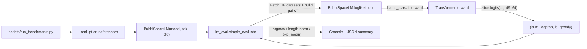

# How Base-LM Evaluation Actually Works with `lm-evaluation-harness`

When you train a base language model from scratch — no supervised fine-tuning, no chat template, no RLHF — you cannot judge its quality by asking it to "answer with the letter B" or follow a prompt rubric. A raw pretrained model is a next-token probability distribution, not an assistant. Ask it to generate a chat response and you mostly measure formatting luck, not world knowledge or language modeling quality.

That is why standard base-model suites evaluate checkpoints through **log-likelihood scoring**, not free-form generation. In BubblSpace MoE-0.9B-A0.2B, we run six zero-shot benchmarks via EleutherAI's `lm-evaluation-harness`:

```text
hellaswag, piqa, arc_easy, arc_challenge, winogrande, lambada_openai
```

If you have ever wondered *who* downloads these datasets, *how* multiple-choice questions get turned into forward passes without the model ever outputting `"A"` or `"B"`, why WinoGrande is structurally backwards from the others, and where held-out perplexity fits in, this walkthrough traces the exact execution path through [`scripts/run_benchmarks.py`](../scripts/run_benchmarks.py) and [`src/eval/lm_eval_adapter.py`](../src/eval/lm_eval_adapter.py).

---

## The Mental Model: Who Does What?

The cleanest way to understand `lm-evaluation-harness` is as a strict separation of responsibilities:

- **The harness owns the benchmark.** It resolves task names in its registry, downloads and caches the Hugging Face datasets on first run, turns each dataset row into prompt/continuation pairs, calls your model for log-probabilities, computes `acc`, `acc_norm`, `perplexity`, and standard errors, and aggregates the final report. Nothing in this repository fetches benchmark datasets or computes accuracy.
- **Your adapter owns one question:** *"Given this context string, how likely is this continuation string under my model?"*

Because our `Transformer` (`src/model/transformer.py`) is a custom PyTorch `nn.Module` rather than a Hugging Face `transformers`-native architecture, the harness's built-in `HFLM` wrapper cannot load it. Instead, [`src/eval/lm_eval_adapter.py`](../src/eval/lm_eval_adapter.py) subclasses EleutherAI's `lm_eval.api.model.LM` directly as `BubblSpaceLM`. (See [What It Takes to Make a Custom MoE Transformers-Native](transformer-native.md) for what is required to drop this adapter and run `lm_eval --model hf` directly.)



---

## Inside the Runner and Adapter

### 1. Entry Point: `scripts/run_benchmarks.py`

Running a benchmark pass against any checkpoint looks like this:

```bash
python scripts/run_benchmarks.py \
    --config configs/base.yaml \
    --checkpoint /path/to/step_6000.pt \
    --tasks hellaswag,piqa,arc_easy,arc_challenge,winogrande,lambada_openai \
    --output results/step_6000.json
```

The script handles four setup steps before handing control to the harness:

1. **MoE backend resolution:** If `cfg.model.moe.backend == "auto"`, it probes `torch._grouped_mm` once via `probe_grouped_mm()` and selects `"grouped_mm"` on capable CUDA builds or `"fallback"` otherwise.
2. **Checkpoint loading:** `load_weights()` inspects the extension. A `.safetensors` file is loaded straight into `model.load_state_dict(...)`. A training `.pt` checkpoint contains optimizer and scheduler state alongside the weights, so it extracts `ckpt["model"]` (and reads `ckpt.get("step")` for metadata) while ignoring training state.
3. **Wrapping the model:** It sets `model.eval()`, wraps `(model, tok, cfg, device)` in `BubblSpaceLM`, and calls `lm_eval.simple_evaluate(model=lm, tasks=task_list, limit=args.limit)`.
4. **Persisting results:** It prints `results["results"]` and optionally writes a JSON file alongside the checkpoint path, step, task list, and `--limit`.

### 2. Scoring a Single Pair: `BubblSpaceLM._score_continuation`

All six default benchmarks only ever invoke `BubblSpaceLM.loglikelihood(requests)`. Each `Instance` carries `(context, continuation)` in `req.args`. Both strings are encoded with `add_special_tokens=False` and passed to `_score_continuation`:

```python
full_enc = context_enc + continuation_enc
inp = torch.tensor([full_enc[:-1]], dtype=torch.long, device=self.device)
targets = torch.tensor(full_enc[1:], dtype=torch.long, device=self.device)

with torch.autocast(device_type=self.device, dtype=self._autocast_dtype, enabled=(self.device == "cuda")):
    logits, _, _, _ = self.model(inp)
logits = logits[0, :, : self.real_vocab_size].float()

cont_len = len(continuation_enc)
cont_logits = logits[-cont_len:]
cont_targets = targets[-cont_len:]

log_probs = F.log_softmax(cont_logits, dim=-1)
token_logprobs = log_probs.gather(1, cont_targets.unsqueeze(-1)).squeeze(-1)
greedy_tokens = cont_logits.argmax(dim=-1)
is_greedy = bool((greedy_tokens == cont_targets).all().item())

return token_logprobs.sum().item(), is_greedy
```

Four implementation details here are easy to overlook, and each one matters for exactness:

1. **Teacher-forced next-token shift:** Concatenating `context_enc + continuation_enc` into `full_enc` and feeding `full_enc[:-1]` against targets `full_enc[1:]` aligns position `t` with predicting token `t + 1`. Taking the trailing `cont_len` positions scores *only* the continuation tokens, conditioned on the full context plus every preceding continuation token.
2. **Boundary handling (empty context & overflow):** If `context_enc` is empty (for instance, in an unconditional probability check), the adapter prepends `[self.eot_token_id]` so the first continuation token still has a preceding input token. If `len(context_enc) + len(continuation_enc) > max_seq_len` (`2048`), it truncates the context from the left so the immediate prefix before the continuation is preserved.
3. **Slicing out the padded vocabulary tail:** Our tokenizer (`bubblspace-tokenizer`) has **49,164** real tokens, while `model.vocab_size` is padded to **49,280** (a multiple of 128 for Tensor Core alignment). During training (`scripts/train.py`), those 116 unused output rows are sliced out before cross-entropy so they never appear in the softmax denominator. `BubblSpaceLM` applies the exact same slice (`logits[0, :, : self.real_vocab_size].float()`) before `log_softmax` and `argmax`. Skipping that slice would let untrained padding rows leak probability mass—or even win `argmax`.
4. **Why `batch_size = 1`:** Our `Attention` module (`src/model/attention.py`) calls `F.scaled_dot_product_attention(..., is_causal=True)` with no `attention_mask` support. That is ideal for packed, fixed-length `2048`-token training sequences, but batching variable-length eval requests requires padding masks so pad tokens do not corrupt keys, values, or RoPE positions. Running unbatched (`batch_size=1`) guarantees exact math, and a few thousand short forward passes take only a tiny fraction of a 19k-step H100 training run.

What about `generate_until()`? It is implemented in `BubblSpaceLM` (greedy decoding up to `max_gen_toks` with `until` stop strings) purely for interface completeness in case someone passes a generative task later. None of the six default benchmarks call it.

---

## How Each Benchmark Turns Rows into `(context, continuation)` Pairs

Every multiple-choice task in `lm-evaluation-harness` shares one subtle formatting convention: **`target_delimiter`** (default `" "`, a single leading space). The harness prepends that space to each continuation string rather than leaving it on the context. With BPE tokenizers like our SmolLM2-based tokenizer, leading whitespace is part of the word token (`" thermometer"` vs `"thermometer"`). Putting the space on the continuation ensures the model scores a normal word token instead of a glued-on suffix.

Below is what the harness actually sends into `BubblSpaceLM.loglikelihood()` for each of the six tasks in zero-shot mode.

### 1. HellaSwag — One Context, Four Endings

HellaSwag tests commonsense physical/situational continuation. Each validation row carries an `activity_label`, two context fragments (`ctx_a`, `ctx_b`), four candidate `endings`, and a `label` index.

**Raw dataset row:**

```text
activity_label: "Removing ice from a car"
ctx_a:          "A man scrapes the windshield."
ctx_b:          "he"
endings: [
  "then puts the scraper in the trunk.",
  "starts dancing on the roof.",
  "pours coffee on the glass.",
  "throws the scraper into the street.",
]
label: "0"
```

**Pairs sent to `loglikelihood` (4 requests):**

The harness cleans WikiHow bracket artifacts, capitalizes `ctx_b`, and builds one shared query with four continuations:

```text
1. ("Removing ice from a car: A man scrapes the windshield. He", " then puts the scraper in the trunk.")
2. ("Removing ice from a car: A man scrapes the windshield. He", " starts dancing on the roof.")
3. ("Removing ice from a car: A man scrapes the windshield. He", " pours coffee on the glass.")
4. ("Removing ice from a car: A man scrapes the windshield. He", " throws the scraper into the street.")
```

**How the harness scores it:**

- **`acc`**: picks `argmax(lls)` over the four summed continuation log-probabilities and checks whether it matches `label` (`0`).
- **`acc_norm`**: divides each continuation's summed log-probability by the **character length** of that choice string (`lls / completion_len`), then takes `argmax`. Because every extra token adds another negative log-probability term, raw `acc` systematically favors shorter endings; `acc_norm` corrects that length bias and is the headline number usually reported for HellaSwag.

---

### 2. PIQA — One Goal, Two Solutions

PIQA (Physical Interaction QA) tests everyday physical commonsense.

**Raw dataset row:**

```text
goal:  "How do you loosen a stuck jar lid?"
sol1:  "Run hot water over the lid, then twist."
sol2:  "Put the jar in the freezer overnight."
label: 0
```

**Pairs sent to `loglikelihood` (2 requests):**

```text
1. ("Question: How do you loosen a stuck jar lid?\nAnswer:", " Run hot water over the lid, then twist.")
2. ("Question: How do you loosen a stuck jar lid?\nAnswer:", " Put the jar in the freezer overnight.")
```

**How the harness scores it:**

Same mechanism as HellaSwag: `acc` compares raw summed continuation log-probabilities, and `acc_norm` normalizes by choice character length. Notice that option letters like `"A"` or `"B"` never appear anywhere in the prompt—the model directly compares the plausibility of the full answer texts.

---

### 3. ARC-Easy and ARC-Challenge — One Question, N Answer Choices

Both `arc_easy` and `arc_challenge` come from `allenai/ai2_arc` and use the exact same prompt template and scoring rule. The only difference is the split (`ARC-Easy` vs the harder `ARC-Challenge` subset of grade-school science questions).

**Raw dataset row:**

```text
question:      "Which tool measures temperature?"
choices.text:  ["ruler", "thermometer", "scale", "clock"]
choices.label: ["A", "B", "C", "D"]
answerKey:     "B"
```

**Pairs sent to `loglikelihood` (N requests, usually 4, occasionally 3 or 5):**

```text
1. ("Question: Which tool measures temperature?\nAnswer:", " ruler")
2. ("Question: Which tool measures temperature?\nAnswer:", " thermometer")
3. ("Question: Which tool measures temperature?\nAnswer:", " scale")
4. ("Question: Which tool measures temperature?\nAnswer:", " clock")
```

**How the harness scores it:**

The harness maps `answerKey` to an index via `choices.label.index(answerKey)` (here `"B"` -> `1`) and computes `acc` and `acc_norm` over the choice strings. Again, the model never has to know what multiple-choice letter labels mean; it only scores the actual candidate answers.

---

### 4. WinoGrande — The Inverted Case (Two Contexts, One Shared Tail)

WinoGrande tests pronoun/coreference resolution with minimal pairs, and its harness implementation is the opposite of HellaSwag, PIQA, and ARC.

**Raw dataset row:**

```text
sentence: "The trophy does not fit in the suitcase because _ is too large."
option1:  "trophy"
option2:  "suitcase"
answer:   "1"
```

If you scored the option words themselves, a model could cheat simply because `"trophy"` is more common in general English than `"suitcase"`. Instead, the harness uses **`multiple_input` mode**: it splits the sentence at the blank `_`, plugs each option into the **context**, and scores both contexts on the **exact same shared continuation tail**:

**Pairs sent to `loglikelihood` (2 requests):**

```text
1. ("The trophy does not fit in the suitcase because trophy",   " is too large.")
2. ("The trophy does not fit in the suitcase because suitcase", " is too large.")
```

**How the harness scores it:**

It compares:

$$P(\text{" is too large."} \mid \text{"...because trophy"}) \quad \text{vs.} \quad P(\text{" is too large."} \mid \text{"...because suitcase"})$$

`answer: "1"` maps to index `0` (`option1`). Because both pairs score the *identical* continuation string, their lengths are guaranteed to be equal—so length normalization is meaningless and WinoGrande reports only `acc` (no `acc_norm`).

---

### 5. LAMBADA (`lambada_openai`) — One Passage, One Final Word

LAMBADA is not multiple choice at all (`output_type: loglikelihood`). It tests whether the model can track long-range narrative context well enough to predict the final word of a passage.

**Raw dataset row:**

```text
text: "Alice opened the window. Outside she saw a bright garden"
```

**Pair sent to `loglikelihood` (1 request):**

The harness splits on whitespace, puts everything except the final word in `context`, and puts `" " + last_word` in `continuation`:

```text
1. ("Alice opened the window. Outside she saw a bright", " garden")
```

**How the harness scores it:**

Here, both elements of the `(ll, is_greedy)` tuple returned by `BubblSpaceLM.loglikelihood()` are used directly:

- **`acc`**: `int(is_greedy)`. Every single token of the final word must match the model's greedy `argmax` prediction. If `" garden"` is one token, the model's top-1 logit must be that token. If a rarer final word splits into two BPE subwords, *both* subwords must be the top-1 argmax in sequence.
- **`perplexity`**: aggregated across the test set as $\exp\left(-\frac{1}{N}\sum_{i=1}^{N} \text{ll}_i\right)$, where each $\text{ll}_i$ is the summed log-probability of the entire final word (so a multi-token final word still contributes one whole-word log-probability).

---

### Quick Reference Across the Six Tasks

| Task | `output_type` | Requests / Example | What Varies Across Requests | Reported Metrics |
| :--- | :--- | :---: | :--- | :--- |
| `hellaswag` | `multiple_choice` | 4 | Continuation (4 endings) | `acc`, `acc_norm` |
| `piqa` | `multiple_choice` | 2 | Continuation (2 solutions) | `acc`, `acc_norm` |
| `arc_easy` / `arc_challenge` | `multiple_choice` | N (usually 4) | Continuation (answer texts) | `acc`, `acc_norm` |
| `winogrande` | `multiple_choice` (`multiple_input`) | 2 | **Context** (blank filled); tail shared | `acc` |
| `lambada_openai` | `loglikelihood` | 1 | Single `(passage, " " + last_word)` pair | `acc` (via `is_greedy`), `perplexity` |

---

## Held-Out Perplexity: What Exists Today (and What Doesn't)

It is easy to assume a training repository automatically tracks validation perplexity, so it is worth being explicit about what is currently wired up:

1. **No validation loop in training (`scripts/train.py`):** During pretraining, `scripts/train.py` computes and logs cross-entropy (`ce_loss`), MoE load-balance loss (`lb_loss`), and router z-loss (`z_loss`) strictly on the training stream. There is no held-out validation dataloader or standalone perplexity script in `scripts/`.
2. **Rolling perplexity is supported via the harness (`loglikelihood_rolling`):** `BubblSpaceLM` implements `loglikelihood_rolling(requests)`, which is the method `lm-evaluation-harness` calls for perplexity benchmarks such as `wikitext`. It is not in `DEFAULT_TASKS`, so the default command never invokes it, but you can run it immediately by adding `wikitext` to `--tasks`:

```bash
python scripts/run_benchmarks.py \
    --config configs/base.yaml \
    --checkpoint /path/to/step_6000.pt \
    --tasks wikitext
```

### How `loglikelihood_rolling` Works in `BubblSpaceLM`

For rolling perplexity tasks, each `Instance` contains a single document string `(text,)` rather than a `(context, continuation)` pair. `BubblSpaceLM.loglikelihood_rolling()` tokenizes the document and walks it in **non-overlapping chunks of `stride = max_seq_len` (`2048`)**:

- Each chunk runs one forward pass (`inp = chunk[:-1]`, `targets = chunk[1:]`), slices logits to `:real_vocab_size` (`49,164`), and sums token log-probabilities.
- The adapter returns the total document log-probability `total_logprob`.
- The harness divides that log-probability by the document's word count and UTF-8 byte count to report `word_perplexity`, `byte_perplexity`, and `bits_per_byte`.

Because the windows do not overlap, the first tokens of chunk 2 are conditioned only on the start of chunk 2 rather than the tail of chunk 1. That is the standard `lm-evaluation-harness` fast simplification (good enough for consistent checkpoint-to-checkpoint sanity checks and much cheaper than a densely strided sliding window, where every chunk overlaps heavily). Note also that the very first token of each chunk has no preceding token in `chunk[:-1]` (so `len(chunk) - 1` transitions are scored per chunk).

### If You Want a Dedicated Held-Out FineWeb-Edu Perplexity Check

If you later want an in-distribution held-out perplexity metric alongside `wikitext` (for example, a fixed FineWeb-Edu slice excluded from `src.data.prepare`), you have two lightweight options:

- **Standalone script (~40 lines):** Read a held-out `.bin` shard with the same `uint16` memmap reader from `src/data/dataset.py`, run `model(x)` under `torch.no_grad()` and `bf16` autocast over fixed `2048`-token windows (slicing `:real_vocab_size` identically to `scripts/train.py`), and report `mean_ce` and `math.exp(mean_ce)`. Because it uses fixed `2048`-token blocks with no padding, you can batch it (`micro_batch=16`) without changing `Attention`.
- **Custom harness task YAML:** Point a local `lm_eval` task YAML with `output_type: loglikelihood_rolling` at your held-out JSONL/Parquet file and pass `--include_path` to `lm_eval`.

---

## Results Log

### step_7000 (2026-11-20)

Checkpoint: `step_7000.pt` — step 7,000 / 19,073 planned steps (~37% through
the single 10B-token FineWeb-Edu pretraining run), loss ≈2.8 at this point.
Tokens seen so far: 7,000 × 524,288 ≈ **3.67B** (of a 10B-token total planned
for this entire run). Raw results: [`benchmark/step_7000.json`](../benchmark/step_7000.json).

| Task | Metric | Score | Random baseline |
|---|---|---|---|
| PIQA | acc_norm | 64.7% | 50% (2-choice) |
| ARC-Easy | acc_norm | 51.1% | ~25% (multi-choice) |
| HellaSwag | acc_norm | 37.0% | 25% (4-choice) |
| LAMBADA (openai) | acc (exact last-word match) | 29.0% | ~0% (strict exact-match) |
| LAMBADA (openai) | perplexity | 58.1 | — |
| WinoGrande | acc | 52.4% | 50% (2-choice) |
| ARC-Challenge | acc_norm | 28.0% | 25% (4-choice) |

**Read:** tasks that reward broad surface-pattern learning (PIQA, ARC-Easy,
HellaSwag) are clearly above chance already. LAMBADA's strict exact-match
accuracy (29%) is a genuinely positive signal of real language-modeling
quality this early. The two hardest, most reasoning-heavy benchmarks
(ARC-Challenge, WinoGrande) sitting near chance is expected at this model
size (~915M total / ~211M active) and training stage — not a sign of a
problem.

#### Comparison against other models of similar scale

| Task | **Ours (step_7000)** | GPT-2-124M (fully trained) | Pythia-160M (fully trained) | Pythia-410M (fully trained) | SmolLM2-360M (fully trained, curated data) |
|---|---|---|---|---|---|
| PIQA | 64.7% | 62.9% | 73.1% | 74.1% | 77.6% |
| ARC-Easy | 51.1% | 39.5% | 46.3% | 51.2% | ~61.0%* |
| ARC-Challenge | 28.0% | ~19%** | 19.2% | 21.8% | ~61.0%* |
| HellaSwag | 37.0% | 31.1% | — | — | 69.3% |
| WinoGrande | 52.4% | 51.6% | 59.2% | 59.3% | 61.1% |
| LAMBADA acc | 29.0% | 32.6% | 63.3% | 65.7% | — |

\*SmolLM2's reported "ARC" is an E+C average, not split — not perfectly
comparable to our per-split numbers.
\*\*Commonly-cited approximate figure; less firmly sourced than the others
in this table.

#### How many tokens were these comparison models actually trained on?

| Model | Training tokens | Notes |
|---|---|---|
| **Ours (step_7000)** | ~3.67B seen so far (**10B planned total** for the entire run) | Single pass (not multiple epochs) over FineWeb-Edu `sample-10BT` |
| GPT-2-124M | ~8-9B unique tokens (WebText), ~10-53B total across training | WebText itself is ~8-9B tokens; the original paper does not state an exact epoch count, so total tokens-seen estimates vary by source |
| Pythia-160M / 410M | ~300B tokens (exactly 299,892,736,000) | 1 epoch over the Pile: 143,000 steps × 1024 batch × 2048 seq_len — precisely documented in the Pythia paper |
| SmolLM2-360M | ~4T tokens (4,000B) | Multi-stage curated-data curriculum (same tokenizer family as ours) |

**Why this context matters:** our model is already ahead of GPT-2-124M on
most tasks and competitive with the fully-trained Pythia-160M on ARC-Easy/
ARC-Challenge — despite still being mid-training *and* working with a far
smaller total token budget (10B) than every comparison point here (30x
smaller than Pythia's 300B, over 1000x smaller than SmolLM2's 4T). That
makes the LAMBADA gap unsurprising (it specifically rewards precise
long-range calibration, which scales strongly with total tokens seen) and
reframes the strong early showing elsewhere as a genuinely efficient result
for the architecture, not just "it got lucky" — though it also means this
run's *final* checkpoint will still never catch up to Pythia-410M or
SmolLM2-360M on raw data volume alone.

Caveat: this is not a perfectly apples-to-apples comparison — these models
differ in total/active parameter split (ours is MoE: 915M total / 211M
active, vs. fully dense comparisons), training token budgets, and possibly
minor eval-harness version differences across sources.

Sources: [Pythia paper](https://arxiv.org/pdf/2304.01373),
[EleutherAI/pythia-160m-v0](https://huggingface.co/EleutherAI/pythia-160m-v0),
[SmolLM2 paper](https://arxiv.org/pdf/2502.02737).

---

## Next Step: Dropping the Custom Adapter Altogether

`BubblSpaceLM` works cleanly today because it hides our custom `Transformer.forward()` signature and works around the lack of padding masks by running at `batch_size=1`. If you want to understand what it would take to package BubblSpace MoE-0.9B-A0.2B so `AutoModelForCausalLM.from_pretrained(...)` and `lm_eval --model hf` can load it natively, continue to [What It Takes to Make a Custom MoE Transformers-Native](transformer-native.md).
