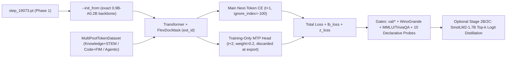

> **About this document.** This is a copy of the pre-Phase 2 design review scratchpad
> (originally `temp/scratchpad01_pre_phase2.md`, which isn't committed). It records the
> semantic-understanding diagnosis of the Phase 1 model and the plan debate that produced
> the final Phase 2 design. The original was kept verbatim below, including rejected ideas.
>
> **What actually shipped differs from the "Final Detailed Plan" below in three ways:**
> - The **MTP head** and **SmolLM2-1.7B distillation** were kept off, as a decision for mid-run.
> - A **contrastive entity-binding pool** was added (`scripts/gen_contrastive.py`; 1.5% in Stage 2A, 6% in 2B).
> - The final group weights were English 41.5 / code 49 / agentic 8 / contrastive 1.5 in Stage 2A,
>   and 34 / 38 / 22 / 6 in Stage 2B. See [`configs/phase2.yaml`](../configs/phase2.yaml) and
>   [storyboard 04](storyboard/04-Phase2-Trainig.md).

# Scratchpad 01 — Pre-Phase 2 Semantic Understanding Diagnosis & Plan

> **Purpose:** Recurring multi-agent scratchpad for discussing, auditing, and refining the pre-Phase 2 design for `bubblspace-MoE0.9B-A2b` (≈915.6M total / ≈211M active params, 16 layers, `d_model=1024`, 64 experts, `top_k=8`, `expert_hidden=256`, GQA 16/4 with QK-norm + output gate, `ZeroCenteredRMSNorm`, Muon + AdamW).
> **Convention:** Append new entries at the bottom with `**Speaker (YYYY-MM-DD HH:MM UTC+5:30):**`. Do not delete prior reasoning so all agents have full decision history, including rejected ideas and pushbacks.

---

## Discussion Log

### Amardeep (2026-11-21 11:20 UTC+5:30)
Flagged that semantic understanding of the Phase 1 base model looks very weak in interactive completions. Explicitly ruled out hand-waving with "small model capacity" — we are innovating and want to examine the Phase 2 plan and root causes directly.

Shared raw interactive base-model completions (7 conversational prompts):
- `"tell me more about william shakespea"` -> got basic bio right (`english playwright, poet, and actor`), then drifted into SEO essay-mill scrape (`Free william shakespea papers... her late husband, william shakespeare`).
- `"can you tell me more about riemann hypothesis?"` -> hallucinated unrelated cosmology (`all of the matter in the universe is concentrated somewhere in a small void... called the Gk`).
- `"whic his best ancient indian text?"` -> activated Sanskrit/Vedas cluster, then hallucinated (`'Kama' in Sanskrit means 'fire', 'smoke'... 'vasthu' meaning 'vayu'`).
- `"repeat the last 3 questions i asked you"` -> completed as a YouTube script (`to answer during the video.<|endoftext|>`).
- `"which is capital of India and USA"` -> dropped `"capital"` and `"USA"`, fell into a repetitive essay loop on Indian families.
- `"capital of India is ?"` -> format-hijacked into scraped Indian exam MCQs (`(a) Hindu religion... 12. Which among the following is not a condition of Sikhism?`).
- `"tell me more about India"` -> blog comment + broken wiki-table scrape (`10 Famous Places In North India |1||The Great Wall of China| |9||The Taj Mahal in India|`).

---

### Cursor (2026-11-21 11:22 UTC+5:30)
Audited the full codebase (`configs/base.yaml`, `src/model/transformer.py`, `src/model/block.py`, `src/model/attention.py`, `src/model/moe.py`, `src/model/rope.py`, `src/model/norm.py`, `src/model/init.py`, `src/optim/muon.py`, `src/optim/param_groups.py`, `src/optim/schedule.py`, `src/data/prepare.py`, `src/data/dataset.py`, `scripts/train.py`, `scripts/prepare_agentic.py`) and planning docs (`doc/plan-02-phase-2-continual-training.md`, `doc/issue-01-phase2.md`, `doc/continual-training.md`, `doc/eval-notes.md`).

Key findings:
1. **No implementation bugs in Phase 1 model or optimizer:** `rope.py`, `ZeroCenteredRMSNorm`, GQA + QK-norm + sigmoid output gate, `MoEFFN`, and `Muon` Newton-Schulz are all mathematically clean.
2. **MoE per-expert token starvation:** With 64 experts and `top_k=8`, each expert sees only `1/8` of the token stream (≈1.25B tokens/expert by end of 10B Phase 1).
3. **Single-source noisy web distribution:** Phase 1 is 100% `HuggingFaceFW/fineweb-edu` (`sample-10BT`) — 0% Wikipedia, 0% math/STEM, heavy web-scrape artifacts (essay mills, MCQs, broken tables).
4. **Current Phase 2 plan (`doc/plan-02-phase-2-continual-training.md`) will not fix English semantics:** Pool A is only 26.0% overall (3.12B), half of which (1.60B) is reused Phase 1 FineWeb-Edu — adding only ≈190M *new* English tokens per expert (`cosmopedia-v2`) — and Stage 2B anneal drops English to **16%** while putting 59% into Code and 25% into Agentic, still with 0% Wikipedia and 0% math/STEM.
5. **Cross-document attention contamination:** `src/model/attention.py` runs `F.scaled_dot_product_attention(..., is_causal=True)` with no document mask across `<|endoftext|>`, while `src/data/dataset.py` slices random 2048-token windows across concatenated documents. This also affects `scripts/prepare_agentic.py`, which packs multiple episodes into 2048-token blocks separated by `eot_id` (Episode 2 can attend to Episode 1's `<tools>` schema).
6. **Diagnostic proposed:** Because all 7 prompts were conversational/question prompts fed to a base model, asked Amardeep to run 4 short declarative completions (`The capital of the United States is`, `The capital of India is`, `The Riemann hypothesis is a mathematical conjecture about`, `In Sanskrit, the word Kama means`) to separate base-model format-hijacking from genuine entity-binding failure.

---

### Amardeep (2026-11-21 11:23 & 11:43 UTC+5:30)
Pushed back on a "data-only" fix: *"data wont help if it cant build sematic understanding properly and has loose connection in phase 01; in fact this is good that we can see how loose semantic understanding is in this case."*

Ran the `step_18000` benchmark suite (≈9.4B tokens seen) and the 4 declarative prompts:

#### `step_18000` Benchmark Results (vs. `step_9000`)
| Task | Metric | `step_9000` | `step_18000` | Delta |
|---|---|---|---|---|
| PIQA | `acc_norm` | 65.9% | **68.8%** | +2.9 |
| ARC-Easy | `acc_norm` | 50.8% | **56.6%** | +5.8 |
| HellaSwag | `acc_norm` | 38.5% | **42.6%** | +4.1 |
| LAMBADA | `acc` | 30.6% | **35.3%** | +4.7 |
| LAMBADA | `perplexity` | 49.3 | **31.0** | -18.3 (better, -37% vs step 7k) |
| **WinoGrande** | **`acc`** | **51.5%** | **50.7%** | **-0.8 (flat at random 50%)** |
| ARC-Challenge | `acc_norm` | 27.2% | **29.9%** | +2.7 |

#### 4 Declarative Prompt Completions (`step_18000`)
1. `The capital of the United States is` -> **`Washington, DC.`** (correct!), then immediately loses entity-attribute binding: `This is a US State. This City is in California. This is a D.C. United States city. This is a US state... This city is in Virginia... This city is in California...`
2. `The capital of India is` -> `a city of great architectural beauty. It was the capital of British India from 1833 to 1931... The British built some of the most important buildings... from the Houses of Parliament in London to the Taj Mahal in India.` (right neighborhood, wrong relational edge: binds `built(British, Taj Mahal)`).
3. `The Riemann hypothesis is a mathematical conjecture about` -> `the geometry of Riemann surfaces... smooth curve that is a Riemann surface of revolution...` (lexical neighbor `"Riemann"` -> `"Riemann surfaces"` instead of zeta function / primes).
4. `In Sanskrit, the word Kama means` -> `breath and is used to describe the actions of the mind leading to pleasure – Kama means breath and vama means actions...` (both `"pleasure"` [Kama] and `"breath"` [Prana] are active nearby, misbinds `"breath"` to `Kama`).

---

### Cursor (2026-11-21 11:45 UTC+5:30)
Synthesized the smoking-gun diagnosis:
- **Fluency, local coherence, and broad commonsense are scaling strongly** (`LAMBADA ppl 58.1 -> 31.0`, `ARC-Easy 56.6%`, `PIQA 68.8%`).
- **WinoGrande flat at `50.7%` (random chance) + all 4 declarative prompts confirm the exact bottleneck:** the model activates the right **semantic neighborhoods**, but fails at **sharp entity-attribute binding** and **multi-sentence state tracking**.
- Initially proposed 3 structural upgrades (intra-document `flex_attention` masking, zero-init shared SwiGLU expert grafting onto `MoEFFN`, and a training-only MTP `t+2` head) + Knowledge/STEM data rebalance, with SmolLM2-1.7B logit distillation deferred to optional Stage 2C.

---

### Amardeep (2026-11-21 15:48 & 16:13 UTC+5:30)
1. **Rejected zero-init shared expert grafting:**
   > *"routed experts already read from and write to the same residual stream, and every token goes through the same attention projections. i dont think shared experts will have much impact you have given decision in a rush"*
2. **Asked about sequencing `transformers`-native:**
   > *"should we do transformer native first before all this?"*

---

### Cursor (2026-11-21 16:16 UTC+5:30)
Accepted both points and updated the final plan:
1. **Dropped shared-expert grafting completely.** Amardeep's critique is right: all 64 routed experts already share the exact same residual stream, embeddings, and all 16 attention layers; routed-only MoEs without shared experts (Qwen3-MoE, OLMoE) do not have a structural relational-binding deficit; and mid-training zero-init grafting onto 64 already-converged experts under a lower Phase 2 LR is unproven while unnecessarily mutating the `0.9B-A0.2B` checkpoint schema.
2. **Do NOT block Phase 2 on `transformers`-native.** Per `doc/transformer-native.md`, `transformers`-native is purely a Hugging Face export/wrapper layer (`config.json`, `configuration_bubblspace.py`, `modeling_bubblspace.py`, `.safetensors`). Phase 2 training still runs on pure PyTorch `src/model/transformer.py` + `Muon` + `torch._grouped_mm` + `torch.compile`, and `scripts/run_benchmarks.py` + `BubblSpaceLM` already works. Because the revised Phase 2 plan keeps the `0.9B-A0.2B` inference architecture 100% unchanged, packaging `transformers`-native cleanly after Phase 2 (heading into Phase 3 SFT/serving) avoids premature wrapper churn. (Only reason to do it earlier in parallel: faster batched `lm_eval --model hf` for large suites like full MMLU.)

---

## Final Detailed Plan — Cursor (2026-11-21 16:16 UTC+5:30)

### Guiding Principles
1. **Zero inference-architecture bloat:** Keep the exact `0.9B-A0.2B` (`~915.6M` total / `~211M` active, 64 experts, `top_k=8`) backbone from `step_19073.pt` untouched at inference/export time.
2. **Fix training mechanics & objective first, then feed dense semantic signal:** Do not run the original Phase 2 plan (63.2% Code / 16% English Stage 2B anneal) as-is, which would starve English entity bindings further.
3. **Validate on CPU + 100-step H100 smoke gate before committing ≈38–42h of H100 compute.**



---

### Part 1 — Training-Mechanic & Objective Upgrades

#### 1.1 Intra-Document Attention Masking (`flex_attention`)
- **Files:** `src/model/attention.py`, `src/model/block.py`, `src/model/transformer.py`, `src/config.py`
- **Problem fixed:** Currently `F.scaled_dot_product_attention(..., is_causal=True)` allows tokens in Document B to attend across `<|endoftext|>` (`eot_id = 0`) into unrelated Document A. This trains attention heads toward short-range recency (hurting WinoGrande and multi-sentence entity tracking) and causes Episode 2 in packed agentic blocks (`scripts/prepare_agentic.py`) to attend to Episode 1's `<tools>` schema.
- **Implementation:**
  - Add `use_doc_mask: bool = False` (default `False` in `configs/base.yaml`, `True` in `configs/phase2.yaml`) and `eot_token_id: int = 0` to model config.
  - In `Transformer.forward(idx, load_tracker=None, return_hidden=False)`:
    - Compute per-token document IDs once per forward pass:
      ```python
      # eot_id terminates a document, so the NEXT token starts a new doc_id
      is_eot = (idx == eot_id)
      doc_ids = is_eot.cumsum(dim=1) - is_eot.to(torch.long)
      ```
    - Build a causal + same-document `BlockMask` via `torch.nn.attention.flex_attention.create_block_mask`:
      ```python
      def doc_causal_mask(b, h, q_idx, kv_idx):
          return (q_idx >= kv_idx) & (doc_ids[b, q_idx] == doc_ids[b, kv_idx])
      ```
    - Pass `block_mask` through `TransformerBlock.forward` -> `Attention.forward`.
    - When `block_mask is not None` and running on CUDA, call `flex_attention(q, k, v, block_mask=block_mask, enable_gqa=(self.n_heads != self.n_kv_heads))`.
    - When `block_mask is None` (inference, `BubblSpaceLM`, Phase 1 eval, or CPU fallback), keep the existing `F.scaled_dot_product_attention(..., is_causal=True)` path untouched.
- **Overhead:** Zero extra parameters; negligible compute overhead under `torch.compile` on H100.

#### 1.2 Training-Only Multi-Token Prediction (MTP, `t+2`) Head
- **Files:** `src/model/transformer.py`, `src/optim/param_groups.py`, `scripts/train.py`, `src/config.py`
- **Problem fixed:** Pure 1-step CE (`t+1`) rewards local phrase plausibility (`This is a US State. This City is in California...`) without forcing the residual stream to commit to multi-token semantic propositions.
- **Implementation (DeepSeek-V3 style, 1 extra step `t+2`):**
  - Add optional `MTPHead(d_model, norm_eps)` enabled when `mtp_weight > 0` (`mtp_weight: 0.2` in `configs/phase2.yaml`, `0.0` in `configs/base.yaml`):
    - Inputs: main trunk hidden states `h_t` (shape `[B, T-1, d_model]`, after `final_norm` or pre-`final_norm`) and next-token embeddings `embed(x_{t+1})` (shape `[B, T-1, d_model]`).
    - Normalize both with `ZeroCenteredRMSNorm`, concatenate along last dim (`[B, T-1, 2*d_model]`), project via `nn.Linear(2 * d_model, d_model, bias=False)`, pass through a single lightweight SwiGLU FFN block (with residual + `ZeroCenteredRMSNorm`), and project to vocabulary using the **tied** `self.embed.weight` (sliced to `:real_vocab_size`).
    - Targets: `y_mtp = y[:, 1:]` (token `t+2`).
    - **Boundary masking (critical):** Set `y_mtp = -100` wherever `x[:, 1:] == eot_id`, `y[:, :-1] == eot_id`, `y[:, :-1] == -100`, or `y[:, 1:] == -100`, so MTP never predicts across `<|endoftext|>` or into padded agentic tails.
    - Loss: `loss = ce_loss + mtp_weight * mtp_ce_loss + load_balance_coef * lb_loss + router_z_loss_coef * z_loss`.
  - Register `mtp_head` 2D projections in `_MUON_SUFFIXES` (or AdamW if preferred — keep consistent with `param_groups.py` strict classification check) and norms in `.w` AdamW group.
  - **Export / inference:** `mtp_head` is completely discarded when exporting weights; inference architecture and latency remain 100% identical to Phase 1.

#### 1.3 Optional / Deferred Lever: Top-k KL Logit Distillation (SmolLM2-1.7B Teacher)
- **Why it is uniquely clean for this repo:** `bubblspace-tokenizer` is **SmolLM2 base (49,152 tokens) + 12/14 special tokens**. That means `HuggingFaceTB/SmolLM2-1.7B` shares the **exact same base vocabulary IDs** — zero tokenizer alignment hack required.
- **Why it targets the exact failure mode:** One-hot CE gives zero negative contrast between close concepts (`Kama` vs `Prana`, `Riemann hypothesis` vs `Riemann surfaces`, `British` vs `Mughal`). Soft teacher logits teach sharp entity separation on every single token.
- **Why deferred to Stage 2B/2C (not Stage 2A):** Running a 1.7B teacher forward pass online on the same single H100 cuts throughput ≈35–45% and adds VRAM/compile complexity on top of `flex_attention` + MTP + multi-pool data.
- **Decision gate:** Evaluate `WinoGrande` + `MMLU/TriviaQA` + the 4 declarative probes mid-Stage 2A (around step 10k). If WinoGrande has broken cleanly upward and entity binding is sharpening, keep Stage 2B pure CE+MTP. If entity contrast is still soft, turn on top-k KL distillation (`k=64`, `T=2.0`, base vocab `[:49152]` masked off on special tokens) during the 2B-token Stage 2B anneal (or a short 1–2B token Stage 2C).

---

### Part 2 — Phase 2 Data Rebalance & Pipeline Fixes

#### 2.1 Revised 12B-Token Mixture (Rebalancing Knowledge + STEM vs. Raw Code)
Update `doc/plan-02-phase-2-continual-training.md` to stay within the **12B-token (≈38–42h H100)** budget while feeding high-density, contradiction-free factual and STEM prose instead of mostly raw StarCoder + noisy FineWeb-Edu:

- **Pool A — Knowledge + STEM + English (≈40.0% overall / 4.80B tokens):**
  - `wikimedia/wikipedia` (`20231101.en`, `text_field="text"`): **≈1.50B tokens** — clean encyclopedic entity bindings (capitals, history, literature, Sanskrit/philosophy, geography).
  - `HuggingFaceTB/smollm-corpus` (`cosmopedia-v2`, `text_field="text"`): **≈1.50B tokens** — clean synthetic textbook explanations.
  - `HuggingFaceTB/finemath` (`finemath-4plus`, `text_field="text"`): **≈1.00B tokens** — mathematical/STEM conceptual prose and multi-step reasoning (fixes math/science grounding like Riemann hypothesis).
  - FineWeb-Edu replay (reused Phase 1 shards): **≈0.80B tokens** — lightweight anti-forgetting anchor (reduced from 1.60B since Wikipedia + Cosmopedia + FineMath already anchor English fluency).
- **Pool B — Code (≈49.2% overall / 5.90B tokens):**
  - `Avelina/python-edu-cleaned`: **1.50B tokens** (curated/educational Python, upweighted in Stage 2B).
  - `bigcode/starcoderdata` (5 focused languages: `python`, `typescript`, `javascript`, `go`, `sql/shell/config`): **≈4.40B tokens** (trimmed proportionally from 4.98B to fund Wikipedia + FineMath).
- **Pool C — Agentic (≈10.8% overall / 1.30B tokens):**
  - Unchanged: ≈375M unique packed tokens (`Nanbeige/ToolMind` 270.4M, `glaiveai/glaive-function-calling-v2` 58.9M, `open-thoughts/OpenThoughts-114k` 17.3M, `NousResearch/hermes-function-calling-v1` 8.9M, `bespokelabs/Bespoke-Stratos-17k` 5.5M) drawn at ≈3.47x oversampling, hard-filtered to `<= 2048` tokens and packed into 2048-aligned blocks.

#### 2.2 Revised Two-Stage WSD Schedule (22,888 steps, 12.0B tokens)
- **LR schedule:** Continue from `step_19073.pt` via `--init_from`; linear re-warmup `6e-5 -> 2.4e-4` over 300 steps, stable plateau at `2.4e-4` through step `19,073` (10.0B tokens), linear/cosine anneal `2.4e-4 -> 6e-6` over final 3,815 steps (`19,073 -> 22,888`, 2.0B tokens).
- **Stage 2A — Plateau (10.0B tokens, steps `0 -> 19,073`):**
  - **41% Knowledge + STEM + English** (4.10B)
  - **51% Code** (5.10B)
  - **8% Agentic** (0.80B)
- **Stage 2B — Anneal (2.0B tokens, steps `19,073 -> 22,888`):**
  - **34% High-Density Knowledge + STEM** (0.68B: `wikipedia` + `cosmopedia-v2` + `finemath-4plus`; **0% raw FineWeb-Edu**)
  - **41% Curated Code** (0.82B: heavily upweighted toward `python-edu-cleaned`)
  - **25% Agentic** (0.50B)

#### 2.3 Confirmed Pipeline & Training Fixes (Retained from `doc/issue-01-phase2.md`)
1. **`src/data/prepare.py`:**
   - Remove file-level `apply_fim()` (move FIM to window-level inside `dataset.py`).
   - Add `--val_tokens` (e.g. `10_000_000`) to carve out a clean held-out `val.bin` per pool excluded from training shards.
   - Keep `--data_dir` (already present in current `prepare.py`) for `bigcode/starcoderdata`.
2. **`src/data/fim.py`:**
   - Add **SPM** alongside **PSM**, 50/50 split (`fim_rate=0.5`), operating on a single document span within a 2048-token window so `<|fim_prefix|>`, `<|fim_suffix|>`, and `<|fim_middle|>` are guaranteed co-resident in the same training window.
3. **`src/data/dataset.py`:**
   - Implement `MultiPoolTokenDataset` sampling named pools (`wiki`, `cosmo`, `finemath`, `en_web`, `code_python_edu`, `code_starcoder_*`, `agentic_packed`) according to a step-dependent Stage 2A/2B schedule.
   - Apply dynamic window-level 50/50 PSM+SPM FIM to code pools respecting `eot_id = 0` boundaries.
   - Sample `agentic_packed` using block-aligned starts (`start = k * 2048`), converting `<|fim_pad|>` targets in `y` to `-100`.
4. **`scripts/train.py`, `src/config.py`, new `configs/phase2.yaml`:**
   - Add `--init_from <ckpt_path>` distinct from `--resume`: loads Phase 1 backbone weights (`strict=False` so training-only `mtp_head` initializes fresh cleanly), loads matching Muon/AdamW optimizer states for backbone parameters (fresh states for `mtp_head`), resets step counter to `0`, and attaches the Phase 2 WSD LR schedule.
   - Pass `ignore_index=-100` to `F.cross_entropy`.
   - Add lightweight per-pool held-out validation loop (`val/wiki`, `val/math`, `val/en`, `val/code`, `val/agentic`) every ≈250 steps.

---

### Part 3 — Verification, Smoke Gate & Semantic-Binding Eval Gates

1. **CPU Unit Tests (mandatory before any H100 spend):**
   - `flex_attention` / doc-mask isolation: verify perturbing tokens in Document A produces **exact zero gradient / logit change** on tokens in Document B across `eot_id`.
   - MTP boundary masking: verify `t+2` loss produces zero gradient on positions crossing `eot_id` or hitting `-100` pad targets, and verify `mtp_head` can be stripped cleanly for inference.
   - FIM window invariants: 50/50 PSM+SPM split, respects `eot_id`, all 3 FIM sentinels always co-resident inside 2048 tokens.
   - Agentic packing & masking: block-aligned starts, no episode >2048, every padded target equals `-100`, every special token encodes to 1 token ID.
   - Multi-pool schedule & `--init_from`: Stage 2A/2B weights sum to `1.0`; `--init_from` preserves Phase 1 backbone logits to `1e-5` at step 0 while starting at Phase 2 step `0`.

2. **100-Step H100 Smoke Gate (from `step_19073.pt` via `--init_from`):**
   - Initial `val/en` matches Phase 1 final loss (confirms clean weight load).
   - `flex_attention` + `torch.compile` compiles cleanly with stable tok/s and no repeated graph recompiles.
   - `grad_norm`, `lb_loss`, and `z_loss` remain stable across the 300-step re-warmup to `2.4e-4`.
   - `mtp_loss` decreases monotonically alongside `ce_loss`.

3. **Semantic-Binding Evaluation Cadence (every ≈2,000 steps):**
   - **Per-pool held-out val loss:** `val/wiki`, `val/math`, `val/en`, `val/code`, `val/agentic`.
   - **Existing 6-task suite** (`hellaswag, piqa, arc_easy, arc_challenge, winogrande, lambada_openai`) with **WinoGrande** tracked as the primary relational-binding gate (target: break decisively above the `50.7%` random floor, while holding other English tasks within ≈1 pt or improving).
   - **Factual/knowledge eval:** add `mmlu` and/or `triviaqa` via `scripts/run_benchmarks.py`.
   - **Deterministic format check:** valid PSM/SPM infilling, valid JSON inside `<tool_call>...</tool_call>`, clean `</think>` closure within 2048 tokens.
   - **Fixed 10-prompt declarative entity-binding probe** (always including the 4 diagnostic prompts: US capital, India capital, Riemann hypothesis, Sanskrit Kama) logged side-by-side per checkpoint to visually verify entity-binding progress.

---

### Part 4 — Post-Phase 2 Sequencing
1. **After Phase 2 completes:** Package `transformers`-native (`config.json`, `configuration_bubblspace.py`, `modeling_bubblspace.py` with `attention_mask` support, BF16 `.safetensors` export stripping `mtp_head`, tokenizer files) per `doc/transformer-native.md`.
2. **Phase 3 — SFT (≈3h H100):** Assistant-only loss masking (`y = -100` on system/user/`<tool_response>`) combining general knowledge QA/chat + code + agentic trajectories so the model learns to retrieve and answer cleanly instead of continuing like web text.
3. **Phase 4 — Optional RL/GRPO:** Only after Phase 3 SFT produces clean stops and valid tool-call JSON.

---

## Open Points for Next Agent / Review
- Confirm exact dataset availability & token yields for `wikimedia/wikipedia` (`20231101.en`) and `HuggingFaceTB/finemath` (`finemath-4plus`) on the data-prep host (both are public Apache/ODC/CC datasets on HF, should be verified live like the other Phase 2 pools).
- Confirm PyTorch version on the H100 training host supports `torch.nn.attention.flex_attention` with `enable_gqa=True` and `torch.compile` without graph breaks alongside `torch._grouped_mm`.
- Decide whether to keep SmolLM2-1.7B top-k logit distillation strictly as an optional Stage 2B/2C contingency (current recommendation) or wire the teacher hook ahead of time.
