# What It Takes to Make a Custom MoE Model `transformers`-Native

When you write a language model from scratch in pure PyTorch, the training code is refreshingly clean: one `nn.Module`, a YAML config, a fast MoE kernel, and a tight forward pass returning logits and auxiliary router losses.

The moment you try to evaluate that checkpoint with ecosystem tooling—`lm-evaluation-harness`, vLLM, TRL, or even a two-line `AutoModelForCausalLM.from_pretrained(...)` script—you hit a wall. None of those tools know how to load your checkpoint. That is why this repository currently carries a custom eval adapter (`BubblSpaceLM` in [`src/eval/lm_eval_adapter.py`](../src/eval/lm_eval_adapter.py)) and a custom runner ([`scripts/run_benchmarks.py`](../scripts/run_benchmarks.py)) instead of invoking `lm_eval --model hf` directly.

This post breaks down what **"transformers-native"** actually means, the exact five artifacts required to package **BubblSpace MoE-0.9B-A0.2B** (~915.6M total / ~211M active parameters) as a native Hugging Face repo, the one genuine attention code change needed for batched evaluation, and why a `bf16` mixed-precision training run shows up as **Tensor type: F32** on the Hugging Face Hub.

---

## The Core Mental Model

A `transformers`-native model is simply a checkpoint that `AutoModelForCausalLM.from_pretrained(...)` can instantiate and run without bespoke loader glue.

Right now, [`src/model/transformer.py`](../src/model/transformer.py) is a plain `torch.nn.Module` designed purely for pretraining:

```python
class Transformer(nn.Module):
    def forward(self, idx: torch.Tensor, load_tracker: ExpertLoadTracker | None = None):
        ...
        return logits, lb_loss, z_loss, hard_counts
```

It has no `config.json`, no `PretrainedConfig`, no `PreTrainedModel`, and a `forward()` signature that expects a training-only `ExpertLoadTracker` and returns a 4-tuple of tensors and Python lists. `BubblSpaceLM` exists solely to hide that gap from `lm-evaluation-harness` (see [How Base-LM Evaluation Actually Works with `lm-evaluation-harness`](eval-notes.md)).

The crucial insight: **making a model `transformers`-native does not change the architecture or the training run.** Your training loop, Muon + AdamW setup, and model math stay untouched. Making it native means wrapping that exact same math in Hugging Face's configuration, module, and output contract.

```mermaid
flowchart TB
    subgraph customPath [Current Custom-Adapter Stack]
        direction LR
        A1["scripts/run_benchmarks.py"] --> A2["BubblSpaceLM(LM)"]
        A2 --> A3["Transformer.forward(idx)"]
        A3 --> A4["(logits, lb, z, counts)"]
    end

    subgraph nativePath [Transformers-Native Stack]
        direction LR
        B1["lm_eval --model hf"] --> B2["HFLM (built-in)"]
        B2 --> B3["AutoModelForCausalLM"]
        B3 --> B4["BubblSpaceForCausalLM.forward(...)"]
        B4 --> B5["CausalLMOutputWithPast(logits=...)"]
    end
```



---

## Anatomy of a Native Model Repo: The 5 Required Artifacts

To let `AutoModelForCausalLM.from_pretrained("TheFireHacker/bubblspace-moe0.9b-a0.2b", trust_remote_code=True)` load the model cleanly, five pieces have to live together in the Hugging Face model repository.

### 1. `config.json`

`config.json` is the entry point `AutoConfig` reads first. It declares four things:

- `model_type`: a unique string identifier (e.g., `"bubblspace_moe"`).
- `architectures`: the causal-LM class name (`["BubblSpaceForCausalLM"]`).
- `auto_map`: pointers telling `transformers` which Python files inside the same repo implement the config and model classes.
- The real architectural hyperparameters from [`configs/base.yaml`](../configs/base.yaml):

```json
{
  "model_type": "bubblspace_moe",
  "architectures": ["BubblSpaceForCausalLM"],
  "auto_map": {
    "AutoConfig": "configuration_bubblspace.BubblSpaceConfig",
    "AutoModelForCausalLM": "modeling_bubblspace.BubblSpaceForCausalLM"
  },
  "vocab_size": 49280,
  "real_vocab_size": 49164,
  "hidden_size": 1024,
  "num_hidden_layers": 16,
  "num_attention_heads": 16,
  "num_key_value_heads": 4,
  "head_dim": 64,
  "qk_norm": true,
  "output_gate": true,
  "attention_bias": false,
  "rope_theta": 10000.0,
  "max_position_embeddings": 2048,
  "rms_norm_eps": 1e-6,
  "num_experts": 64,
  "num_experts_per_tok": 8,
  "moe_intermediate_size": 256,
  "tie_word_embeddings": true,
  "bos_token_id": 0,
  "eos_token_id": 0,
  "torch_dtype": "bfloat16"
}
```

### 2. `configuration_bubblspace.py`

A thin `PretrainedConfig` subclass that mirrors those fields, sets `model_type = "bubblspace_moe"`, and handles serialization (`to_dict()`, `from_pretrained()`). Its job is validating defaults so `AutoConfig.from_pretrained(...)` produces a typed config object that `BubblSpaceForCausalLM(config)` consumes.

### 3. `modeling_bubblspace.py`

A `PreTrainedModel` subclass (`BubblSpaceForCausalLM`) implementing the exact architecture from `src/model/`:

- `ZeroCenteredRMSNorm` (`x * (1.0 + w)` with `w` initialized to zeros, from [`src/model/norm.py`](../src/model/norm.py))
- GQA attention (16 query heads, 4 KV heads, per-head QK-norm applied before RoPE, and the elementwise `sigmoid(X @ W_g)` output gate before `o_proj`, from [`src/model/attention.py`](../src/model/attention.py))
- Dropless top-8 SwiGLU MoE across 64 experts with stacked 3D expert tensors `W_gate`, `W_up`, `W_down` (from [`src/model/moe.py`](../src/model/moe.py))
- Tied input/output embeddings (`tie_word_embeddings = True`)

Three contract rules matter here:

1. **Standard `forward()` signature and return type:**
   `forward(self, input_ids, attention_mask=None, position_ids=None, labels=None, ...)` must return a `CausalLMOutputWithPast` object whose `.logits` tensor has shape `[batch, seq_len, vocab]`. The MoE load-balance loss (`lb_loss`), router z-loss (`z_loss`), and `hard_counts` stay out of that return value (or behind an opt-in flag), and `load_tracker` disappears completely.
2. **Portable MoE compute backend:**
   In [`src/model/moe.py`](../src/model/moe.py), the fast path uses `torch._grouped_mm`—a private, experimental PyTorch op that only runs on supported CUDA/bf16 builds and is not autocast-aware. A public `modeling_bubblspace.py` should keep the `probe_grouped_mm()` check (or default safely to the gather + per-expert fallback on CPU / unsupported GPUs / float32) so anyone calling `from_pretrained(...)` on a laptop or older PyTorch version doesn't hit an opaque kernel crash.
3. **Handling the 116 padded vocabulary rows:**
   Our tokenizer has **49,164** real tokens, while `model.vocab_size` is padded to **49,280** (a multiple of 128). During training (`scripts/train.py`) and in `BubblSpaceLM`, logits are sliced to `:49164` before softmax so the 116 untrained padding rows never enter the denominator. `HFLM` computes `log_softmax` across the entire last dimension of `.logits`. In a native wrapper, you should either mask columns `49164:` to `-inf` (or slice to `real_vocab_size` / trim the embedding table on export) so dead padding rows cannot steal probability mass or win `argmax`.

### 4. Weight Key Mapping & `.safetensors` Export (Plus the `F32` vs `BF16` Mystery)

The training checkpoint's `state_dict` uses compact keys from our training modules:

- `embed.weight`
- `blocks.{i}.norm1.w`, `blocks.{i}.norm2.w`
- `blocks.{i}.attn.{q_proj,k_proj,v_proj,o_proj,gate_proj}.weight`
- `blocks.{i}.attn.{q_norm,k_norm}.w`
- `blocks.{i}.moe.router.weight`
- `blocks.{i}.moe.{W_gate,W_up,W_down}` (stacked `[64, 1024, 256]` and `[64, 256, 1024]` tensors)
- `final_norm.w`

Exporting to Hugging Face is a one-time conversion script: rename keys (if your `PreTrainedModel` uses HF naming conventions like `model.layers.{i}.*`, or simply mirror the existing names inside `BubblSpaceModel` so minimal renaming is needed), declare `_tied_weights_keys` so `safetensors` does not complain about shared memory between embeddings and `lm_head`, and save with `safetensors.torch.save_file`.

#### Why Does the Hugging Face Card Say `Tensor type: F32` When Training Is `bf16`?

This catches almost everyone the first time they upload a training checkpoint to the Hub.

The Hugging Face model card reports the **storage dtype of the tensors inside the `.safetensors` file**, not the compute precision used during training:

- Training in [`scripts/train.py`](../scripts/train.py) is **mixed precision**, not pure `bf16`.
- All **915,573,760** master parameters live in **fp32** (`~3.41 GiB`). Muon and AdamW maintain their optimizer states against—and apply updates to—those fp32 weights.
- Only the forward and backward matmuls run in `bf16` under `torch.autocast(dtype=torch.bfloat16)`. Those transient `bf16` casts are never what gets saved into `step_<n>.pt`.

So if you extract `ckpt["model"]` and write it straight to `.safetensors` without casting, you upload a **~3.4 GiB fp32** file, and the Hub card accurately displays **Tensor type: F32**. Casting the weights down on export (`{k: v.to(torch.bfloat16) for k, v in state_dict.items()}`) cuts the download in half to **~1.7 GiB** (`BF16`). Both `F32` and `BF16` files load cleanly with `AutoModelForCausalLM.from_pretrained(..., dtype=torch.bfloat16)`.

### 5. Tokenizer Files

You already have the exact tokenizer artifacts committed in [`bubblspace-tokenizer/`](../bubblspace-tokenizer/):

- [`bubblspace-tokenizer/tokenizer.json`](../bubblspace-tokenizer/tokenizer.json)
- [`bubblspace-tokenizer/tokenizer_config.json`](../bubblspace-tokenizer/tokenizer_config.json)

Copying those into the model repo lets `AutoTokenizer.from_pretrained(...)` load the identical 49,164-token SmolLM2-based vocabulary (with our chat, FIM, tool-call, and `<think>` special tokens).

One small detail to check before batched evaluation: in `bubblspace-tokenizer/tokenizer_config.json`, `"pad_token"` is currently `null`. For batched HF eval (`batch_size > 1`), `HFLM` needs a pad token ID (typically configured to reuse `eos_token`, `<|endoftext|>`).

---

## The One Real Code Change: Padding Masks in Attention

Everything above is packaging, naming, and wrapper boilerplate. There is **one** genuine modeling change required if you want `transformers`-native evaluation to do more than `BubblSpaceLM` already does: **padding-mask support in attention**.

Look at [`src/model/attention.py`](../src/model/attention.py) today:

```python
attn_out = F.scaled_dot_product_attention(
    q, k, v, is_causal=True, enable_gqa=(self.n_heads != self.n_kv_heads)
)
```

During pretraining, every micro-batch is a dense `[16, 2048]` rectangle packed from tokenized shards—there are no pad tokens anywhere. Unconditional `is_causal=True` is fast, exact, and lets PyTorch dispatch straight to FlashAttention / cuDNN SDPA.

During batched Hugging Face evaluation (`HFLM` with `batch_size > 1`), requests in the same batch have different lengths. To pack them into one tensor, `HFLM` pads the shorter sequences and passes an `attention_mask` of `1`s (real tokens) and `0`s (pad tokens). If `Attention.forward` ignores `attention_mask`:

1. **Cross-contamination from pad tokens:** Real tokens attend to pad tokens (under left-padding) or pad positions pollute attention scores, shifting the continuation log-probabilities and silently producing wrong benchmark numbers.
2. **Shifted RoPE positions:** Under left-padding, the first real token sits at array index `pad_len` instead of position `0`. Without mask-derived `position_ids = attention_mask.long().cumsum(-1) - 1` (clamped at 0), rotary embeddings get assigned the wrong positions.
3. **PyTorch SDPA API constraint:** `F.scaled_dot_product_attention` raises an error if you pass both `is_causal=True` and an explicit `attn_mask`. Whenever a batch contains padding (`attention_mask` has any zeros), you must construct the combined `[bsz, 1, seq_len, seq_len]` causal + key-padding mask and call SDPA with `attn_mask=combined_mask, is_causal=False`. (When `attention_mask is None` or all ones, you keep the fast `is_causal=True` path.)

Without that attention-mask change, a `transformers`-native model will still load and score correctly **only at `batch_size=1`**—which is the exact constraint our `BubblSpaceLM` adapter already operates under.

---

## What Unlocks Immediately — and What Can Wait

Once those five artifacts (and ideally the padding mask) are in the Hugging Face repo, you can drop `BubblSpaceLM` and `scripts/run_benchmarks.py` and run `lm-evaluation-harness` directly from its CLI:

```bash
lm_eval --model hf \
  --model_args pretrained=TheFireHacker/bubblspace-moe0.9b-a0.2b,trust_remote_code=True,dtype=bfloat16 \
  --tasks hellaswag,piqa,arc_easy,arc_challenge,winogrande,lambada_openai
```

Two important distinctions keep the scope realistic:

### `trust_remote_code=True` vs. Upstreaming into `transformers`

`trust_remote_code=True` tells `transformers` to fetch and execute `configuration_bubblspace.py` and `modeling_bubblspace.py` from your Hub repo via `auto_map`. It works immediately for `lm_eval`, `AutoModelForCausalLM`, and most downstream tools.

Dropping the `trust_remote_code=True` flag requires merging your architecture upstream into `huggingface/transformers` itself (adding it to `CONFIG_MAPPING` and `MODEL_FOR_CAUSAL_LM_MAPPING`, writing modular modeling tests, and going through Hugging Face's PR review process). That is a separate milestone and is completely unnecessary just to eliminate the custom eval adapter.

### What You Do *Not* Need Yet: KV-Cache and `generate()`

The six base-model benchmarks (`hellaswag`, `piqa`, `arc_easy`, `arc_challenge`, `winogrande`, `lambada_openai`) and rolling perplexity tasks (`wikitext`) only ever execute `loglikelihood` / `loglikelihood_rolling`—single teacher-forced forward passes over a full sequence. None of them call `model.generate()`.

That means:

- **Needed to replace `BubblSpaceLM`:** `config.json`, `configuration_bubblspace.py`, `modeling_bubblspace.py` (`forward()` -> `CausalLMOutputWithPast`), `.safetensors` weights, tokenizer files, and (for `batch_size > 1`) `attention_mask` support.
- **Can wait until SFT / chat / serving:** `past_key_values` (KV-cache management across decode steps) and `GenerationMixin` integration (`prepare_inputs_for_generation`, `generate()`).

Building the minimal `forward()`-only native wrapper first gets you full compatibility with `lm_eval --model hf` immediately, while leaving KV-caching cleanly decoupled for when the model actually needs autoregressive serving.
